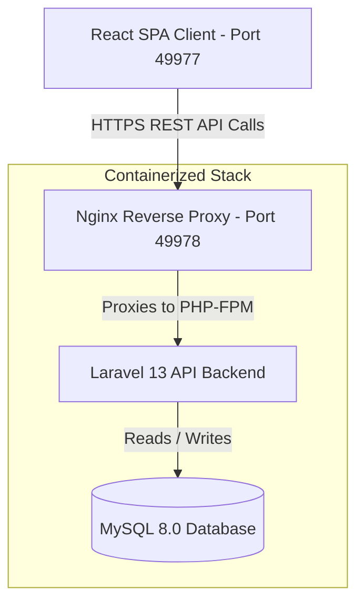
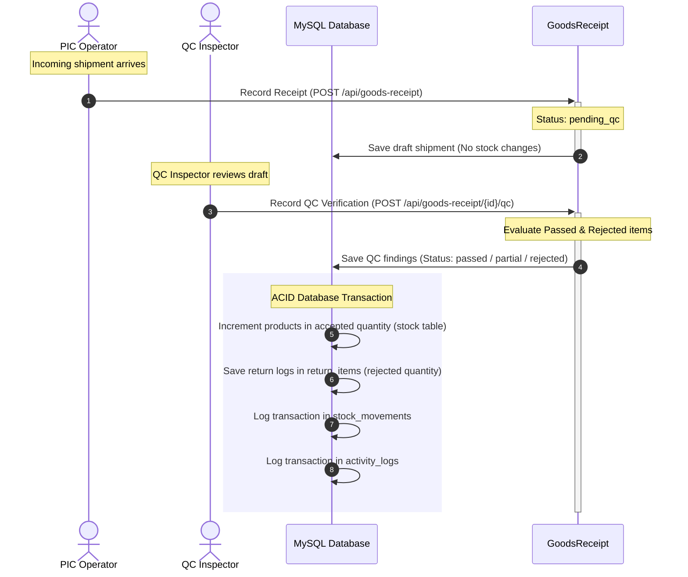
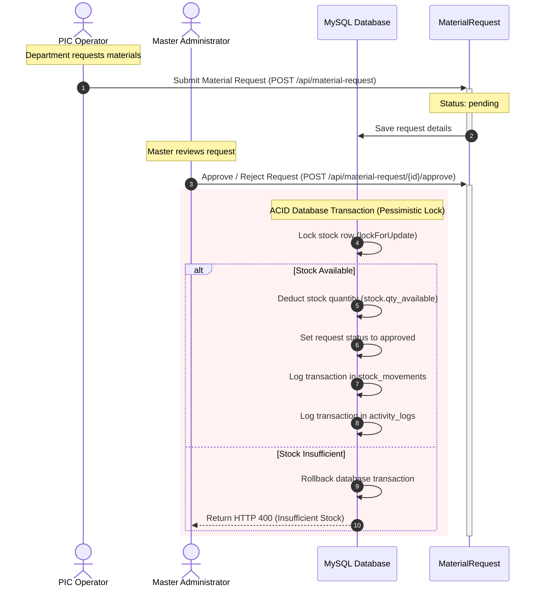
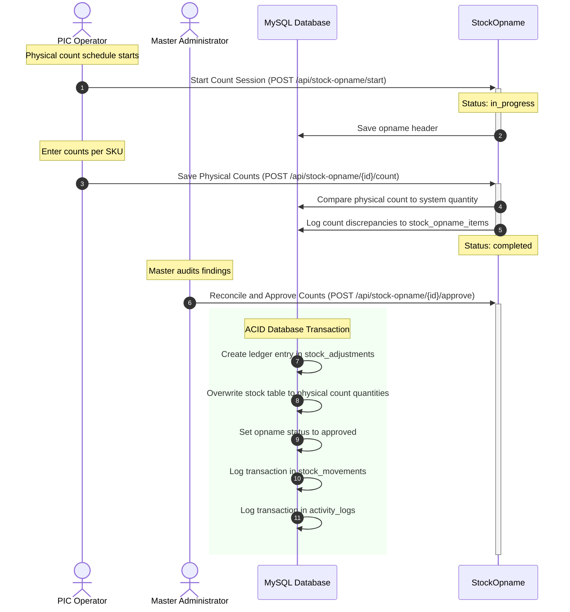
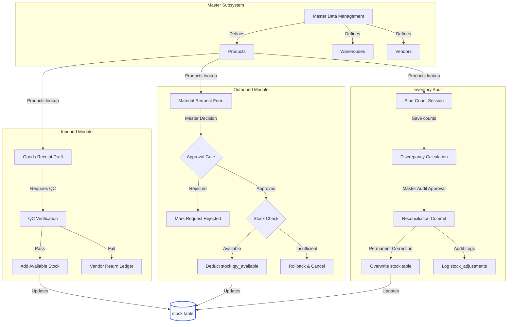

<div align="right">
  <strong>Language Toggle:</strong>
  <b>English</b> |
  <a href="./README_ID.md">Bahasa Indonesia</a>
</div>

# Warehouse Management System (WMS)

An enterprise-grade, integrated Warehouse Management System built to optimize warehouse operations, maintain absolute inventory stock accuracy, enforce quality standards, and provide rigorous administrative oversight for material requests and audits.

---

## System Overview

This Warehouse Management System consists of:
1. **Frontend:** A responsive, state-of-the-art Single Page Application (SPA) built using React 19, structured around clean dashboards, inbound management, outbound requests, quality control inspections, and audit tools.
2. **Backend:** A robust RESTful API built on Laravel 13 (PHP 8.3) utilizing Laravel Sanctum for secure, token-based stateful and stateless authentication, coupled with role-based access control (RBAC).
3. **Database:** A relational MySQL 8.0 instance configured to guarantee ACID compliance for high-frequency inventory mutations and audit logging.
4. **Reverse Proxies:** Containerized Nginx web servers managing static assets for the React SPA and proxying request protocols to PHP-FPM for the Laravel API.

---

## Architectural Workflow

The complete containerized orchestration and request flow of the system is illustrated below:



---

## System Role-Based Access Control (RBAC)

The system enforces four distinct administrative roles to maintain a clear separation of concerns and operational security:

1. **Super Admin (Super Administrator):**
   * Global configuration and system administration privileges.
   * Exclusive access to inspect global system activity log history (Audit Logs).
   * Capability to manage other user accounts and approve/reject new registration requests.
   * Direct multi-warehouse administrative oversight.

2. **Master (Administrator):** 
   * Complete administrative privileges over warehouse master data.
   * Exclusive authority to approve or reject Material Requests.
   * Exclusive authority to approve stock opname reconciliations and execute actual stock level database adjustments.
   * Full dashboard oversight across all branches and warehouses.

3. **PIC (Warehouse Operator):**
   * Responsible for recording incoming shipments (Goods Receipts).
   * Initiates stock opname sessions and logs physical counts.
   * Submits outgoing material requests for department withdrawals.

4. **QC (Quality Control Inspector):**
   * Tasked with incoming shipment inspection.
   * Records passed/rejected item counts on pending Goods Receipts.
   * Authorized to record inspection notes and generate return drafts.

---

## Core Business Workflows

### 1. Inbound Goods Receipt & Quality Control Gate
* **Inbound Record:** A PIC logs a shipment from a vendor using `POST /api/goods-receipt`. The document is generated with a unique transaction number (e.g. `GR-20260530-0001`) and marked with a status of `pending_qc`. No inventory stock balances are altered yet.
* **QC Inspection:** A QC inspector retrieves the pending receipt and records the inspection findings using `POST /api/goods-receipt/{id}/qc`.
* **Stock Mutation & Returns:** The transaction is processed inside an ACID database block:
  * For accepted quantities: The corresponding product stock level inside the `stock` table is incremented.
  * For rejected quantities: A return record is generated inside `return_items` pointing back to the vendor for return processing.

### 2. Outbound Department Material Requests
* **Submission:** A PIC submits a department request for material consumption using `POST /api/material-request`, providing a unique request code (e.g. `MR-20260530-0001`) and indicating the target warehouse and department.
* **Master Decision Gate:** A Master reviews the request and triggers `POST /api/material-request/{id}/approve` or `POST /api/material-request/{id}/reject`.
* **Transaction Execution:** On approval, the system locks the target stock rows using a pessimistic locking mechanism (`lockForUpdate`), checks availability, and deducts the quantity from `stock.qty_available`. If stock is insufficient, the transaction automatically rolls back and returns a descriptive HTTP 400 error listing the out-of-stock items.

### 3. Stock Opname & Audit Reconciliation
* **Session Start:** A PIC starts a stock opname session for a specific warehouse using `POST /api/stock-opname/start`. The session status is set to `in_progress`.
* **Count Intake:** The PIC counts physical items in the warehouse and submits the data using `POST /api/stock-opname/{id}/count`. The system retrieves the current system quantity from the `stock` table, computes the discrepancy (`discrepancy = physical_qty - system_qty`), logs findings to `stock_opname_items`, and sets the status to `completed` (awaiting review).
* **Master Reconciliation Signoff:** The Master signs off on the discrepancies by calling `POST /api/stock-opname/{id}/approve`. Inside a secure database transaction, the system:
  * Creates permanent audit records in `stock_adjustments` detailing the system quantity before, physical quantity after, and discrepancy.
  * Updates the `stock` table to match the verified physical counts, correcting the ledger.

---

## Database Schema Structure

The system uses 17 core relational tables, designed with strict cascading foreign keys and optimized indexes:

### 1. roles
* `role_id` (BIGINT, PK, Auto Increment)
* `role_name` (VARCHAR 50, Unique) - Master, PIC, QC
* `description` (TEXT, Nullable)
* `timestamps`

### 2. warehouses
* `warehouse_id` (BIGINT, PK, Auto Increment)
* `warehouse_name` (VARCHAR 100)
* `address` (TEXT, Nullable)
* `city` (VARCHAR 100, Nullable)
* `pic_id` (BIGINT, FK -> users.id, Nullable)
* `is_active` (BOOLEAN, Default true)
* `timestamps`

### 3. users
* `id` (BIGINT, PK, Auto Increment)
* `role_id` (BIGINT, FK -> roles.role_id)
* `warehouse_id` (BIGINT, FK -> warehouses.warehouse_id, Nullable)
* `name` (VARCHAR 255)
* `email` (VARCHAR 255, Unique)
* `password` (VARCHAR 255)
* `is_active` (BOOLEAN, Default true)
* `remember_token` (VARCHAR 100, Nullable)
* `timestamps`

### 4. vendors
* `vendor_id` (BIGINT, PK, Auto Increment)
* `vendor_name` (VARCHAR 100)
* `contact_person` (VARCHAR 100, Nullable)
* `phone` (VARCHAR 20, Nullable)
* `email` (VARCHAR 100, Nullable)
* `address` (TEXT, Nullable)
* `is_active` (BOOLEAN, Default true)
* `timestamps`

### 5. product_categories
* `category_id` (BIGINT, PK, Auto Increment)
* `category_name` (VARCHAR 100)
* `description` (TEXT, Nullable)
* `timestamps`

### 6. products
* `product_id` (BIGINT, PK, Auto Increment)
* `category_id` (BIGINT, FK -> product_categories.category_id)
* `internal_code` (VARCHAR 50, Unique)
* `product_name` (VARCHAR 100)
* `unit` (VARCHAR 20)
* `description` (TEXT, Nullable)
* `min_stock` (INT, Default 0)
* `is_active` (BOOLEAN, Default true)
* `timestamps`

### 7. vendor_products
* `vendor_product_id` (BIGINT, PK, Auto Increment)
* `vendor_id` (BIGINT, FK -> vendors.vendor_id)
* `product_id` (BIGINT, FK -> products.product_id)
* `vendor_product_code` (VARCHAR 50)
* `vendor_product_name` (VARCHAR 100, Nullable)
* `unit_price` (DECIMAL 15,2, Nullable)
* `is_active` (BOOLEAN, Default true)
* `timestamps`

### 8. departments
* `department_id` (BIGINT, PK, Auto Increment)
* `department_name` (VARCHAR 100)
* `is_active` (BOOLEAN, Default true)
* `timestamps`

### 9. stock
* `stock_id` (BIGINT, PK, Auto Increment)
* `warehouse_id` (BIGINT, FK -> warehouses.warehouse_id)
* `product_id` (BIGINT, FK -> products.product_id)
* `qty_available` (INT, Default 0)
* `qty_reserved` (INT, Default 0)
* `zone` (VARCHAR 10, Nullable)
* `rack` (VARCHAR 10, Nullable)
* `bin` (VARCHAR 10, Nullable)
* `last_updated` (TIMESTAMP, Automatic)
* `timestamps`
* Unique Key: `[warehouse_id, product_id]`

### 10. goods_receipts
* `gr_id` (BIGINT, PK, Auto Increment)
* `gr_number` (VARCHAR 50, Unique)
* `warehouse_id` (BIGINT, FK -> warehouses.warehouse_id)
* `vendor_id` (BIGINT, FK -> vendors.vendor_id)
* `received_by` (BIGINT, FK -> users.id)
* `receipt_date` (DATETIME)
* `receipt_type` (ENUM 'good_receipt', 'pending_order')
* `notes` (TEXT, Nullable)
* `timestamps`

### 11. goods_receipt_items
* `gr_item_id` (BIGINT, PK, Auto Increment)
* `gr_id` (BIGINT, FK -> goods_receipts.gr_id)
* `vendor_product_id` (BIGINT, FK -> vendor_products.vendor_product_id)
* `product_id` (BIGINT, FK -> products.product_id)
* `qty_received` (INT)
* `qty_accepted` (INT, Default 0)
* `qty_rejected` (INT, Default 0)
* `qc_status` (ENUM 'pending', 'passed', 'partial', 'rejected')
* `qc_by` (BIGINT, FK -> users.id, Nullable)
* `qc_date` (DATETIME, Nullable)
* `qc_notes` (TEXT, Nullable)
* `timestamps`

### 12. return_items
* `return_id` (BIGINT, PK, Auto Increment)
* `gr_item_id` (BIGINT, FK -> goods_receipt_items.gr_item_id)
* `product_id` (BIGINT, FK -> products.product_id)
* `vendor_id` (BIGINT, FK -> vendors.vendor_id)
* `qty_returned` (INT)
* `reason` (TEXT, Nullable)
* `return_date` (DATE)
* `returned_by` (BIGINT, FK -> users.id)
* `status` (ENUM 'pending', 'sent', 'acknowledged')
* `timestamps`

### 13. material_requests
* `mr_id` (BIGINT, PK, Auto Increment)
* `mr_number` (VARCHAR 50, Unique)
* `warehouse_id` (BIGINT, FK -> warehouses.warehouse_id)
* `department_id` (BIGINT, FK -> departments.department_id)
* `requested_by` (VARCHAR 100)
* `request_date` (DATETIME)
* `status` (ENUM 'pending', 'approved', 'rejected', 'completed')
* `approved_by` (BIGINT, FK -> users.id, Nullable)
* `approved_date` (DATETIME, Nullable)
* `notes` (TEXT, Nullable)
* `timestamps`

### 14. material_request_items
* `mr_item_id` (BIGINT, PK, Auto Increment)
* `mr_id` (BIGINT, FK -> material_requests.mr_id)
* `product_id` (BIGINT, FK -> products.product_id)
* `qty_requested` (INT)
* `qty_fulfilled` (INT, Default 0)
* `notes` (TEXT, Nullable)
* `timestamps`

### 15. stock_opnames
* `opname_id` (BIGINT, PK, Auto Increment)
* `warehouse_id` (BIGINT, FK -> warehouses.warehouse_id)
* `conducted_by` (BIGINT, FK -> users.id)
* `approved_by` (BIGINT, FK -> users.id, Nullable)
* `start_date` (DATETIME)
* `end_date` (DATETIME, Nullable)
* `status` (ENUM 'draft', 'in_progress', 'completed', 'approved')
* `notes` (TEXT, Nullable)
* `timestamps`

### 16. stock_opname_items
* `opname_item_id` (BIGINT, PK, Auto Increment)
* `opname_id` (BIGINT, FK -> stock_opnames.opname_id)
* `product_id` (BIGINT, FK -> products.product_id)
* `system_qty` (INT)
* `physical_qty` (INT)
* `discrepancy` (INT)
* `notes` (TEXT, Nullable)
* `timestamps`

### 17. stock_adjustments
* `adjustment_id` (BIGINT, PK, Auto Increment)
* `opname_id` (BIGINT, FK -> stock_opnames.opname_id)
* `product_id` (BIGINT, FK -> products.product_id)
* `warehouse_id` (BIGINT, FK -> warehouses.warehouse_id)
* `qty_before` (INT)
* `qty_after` (INT)
* `adjusted_by` (BIGINT, FK -> users.id)
* `adjustment_date` (DATETIME)
* `reason` (TEXT, Nullable)
* `timestamps`

---

## Complete API Specifications

All system requests are prefixed by `/api`. Detailed endpoints are documented below:

### Authentication
* `POST /auth/login` - Accepts JSON `{"email": "...", "password": "..."}`. Returns Sanctum token and authenticated user data.
* `POST /auth/register` - Registers a new user. Restricted access.
* `POST /auth/logout` - Protected. Revokes the active session token.
* `GET /auth/profile` - Protected. Retrieves current session details.

### Dashboard
* `GET /dashboard/summary` - Protected. Aggregates inventory metrics, pending tasks count, active opname counts, and lists active critical low-stock threshold alerts.

### Master Data
* `GET /master/warehouses` - Protected. Lists active warehouses.
* `GET /master/departments` - Protected. Lists active departments.
* `GET /master/vendors` - Protected. Lists active vendors.
* `GET /master/categories` - Protected. Lists product categories.
* `GET /master/products` - Protected. Lists products loaded with their categories.

### Goods Receipt & QC
* `GET /goods-receipt` - Protected. Lists inbound receipts. Eager loads warehouse, vendor, and receiver details.
* `GET /goods-receipt/{id}` - Protected. Displays a detailed receipt with line items.
* `POST /goods-receipt` - Protected (Master, PIC). Submits a new incoming goods shipment.
* `POST /goods-receipt/{id}/qc` - Protected (Master, QC). Logs Quality Control findings, updates stock, and logs vendor returns for rejected products.
* `GET /returns` - Protected. Lists vendor returns logs.

### Material Requests
* `GET /material-request` - Protected. Lists department material request orders.
* `GET /material-request/{id}` - Protected. Displays specific request line items.
* `POST /material-request` - Protected (Master, PIC). Submits a new material consumption request.
* `POST /material-request/{id}/approve` - Protected (Master). Approves request, locks inventory rows, checks thresholds, and deducts stocks.
* `POST /material-request/{id}/reject` - Protected (Master). Rejects request with reasoning logs.

### Stock Opname
* `GET /stock-opname` - Protected. Lists stock opname audit sessions.
* `GET /stock-opname/{id}` - Protected. Displays opname detail and physical counts.
* `POST /stock-opname/start` - Protected (Master, PIC). Starts a new opname count session.
* `POST /stock-opname/{id}/count` - Protected (Master, PIC). Saves physical counts, fetches current system levels, and calculates discrepancies.
* `POST /stock-opname/{id}/approve` - Protected (Master). Approves counting reconciliation, updates physical stock ledger, and logs adjustments.

---

## Comprehensive User Flow

The complete operation sequence in the Warehouse Management System spans three primary workflows. These flows connect the different user roles to secure state transitions inside the relational database.

### 1. Inbound Material Flow (Supplier to Shelf)



### 2. Outbound Material Flow (Request to Issuance)



### 3. Inventory Audit Flow (Stock Opname to Reconciliation)



---

## Complete Feature & Module Flowchart

The high-level integration of the inbound, outbound, audit, and master subsystems is detailed below:



---

## Detailed Running Instructions (Cross-Platform)

The application ecosystem is fully dockerized, making setup uniform across all major environments. Below are the step-by-step instructions to get the application running on Linux, macOS, and Windows.

### Prerequisites (All Operating Systems)
- Docker Desktop (or Docker Engine with Docker Compose v2) installed.
- Git installed.
- Open ports: `49977` (Frontend) and `49978` (Backend API).

---

### 1. Running on Linux (Ubuntu, Debian, Fedora, CentOS)

Linux systems require proper permissions for Docker commands and container volumes.

1. **Extract the Project Source**:
   Extract the provided project ZIP archive and navigate to the extracted directory:
   ```bash
   unzip wmsmuhamad.zip
   cd wmsmuhamad
   ```

2. **Set Executable Permissions on Script Files**:
   Ensure the deployment scripts are executable:
   ```bash
   chmod +x runapp.sh backend/deploy.sh frontend/deploy.sh
   ```

3. **Orchestrate Container Startup**:
   Run the unified setup script from the root folder:
   ```bash
   ./runapp.sh
   ```

4. **Verify Container States**:
   Check if the containers are active and running:
   ```bash
   docker ps
   ```

5. **Examine Log Streams (Troubleshooting)**:
   To view application logs in real-time:
   ```bash
   docker compose -f backend/docker-compose.yml logs -f app
   ```

---

### 2. Running on macOS (Intel and Apple Silicon)

macOS users should utilize Docker Desktop. For Apple Silicon (M1/M2/M3 chips), Docker Desktop automatically handles x86_64 emulation, but running native arm64 builds is highly optimized.

1. **Launch Docker Desktop**:
   Open Docker Desktop from Applications and verify that the Docker daemon is fully started.

2. **Extract the Project Source**:
   Open your Terminal application, extract the provided project ZIP archive, and navigate to the extracted directory:
   ```bash
   unzip wmsmuhamad.zip
   cd wmsmuhamad
   ```

3. **Set File Permissions**:
   ```bash
   chmod +x runapp.sh backend/deploy.sh frontend/deploy.sh
   ```

4. **Start the Application**:
   ```bash
   ./runapp.sh
   ```
   Note: On macOS, if you encounter directory volume mounting permission prompts, click "Allow" to let Docker mount the local workspace folders into the containers.

5. **Verify Access**:
   - Access the React Frontend on: `http://localhost:49977`
   - Access the Laravel Backend on: `http://localhost:49978`

---

### 3. Running on Windows 10 / 11

To achieve optimal performance and Linux compatibility on Windows, it is highly recommended to use **WSL2 (Windows Subsystem for Linux)**.

#### Option A: Running via WSL2 (Recommended)
1. Ensure **WSL2** is enabled and a Linux distribution (such as Ubuntu) is installed.
2. Open Docker Desktop, navigate to **Settings > General**, and verify that **Use the WSL 2 based engine** is checked.
3. Under **Settings > Resources > WSL Integration**, enable integration for your installed Linux distribution (e.g. Ubuntu).
4. Launch your WSL2 terminal (e.g. Ubuntu terminal) and run:
   ```bash
   unzip wmsmuhamad.zip
   cd wmsmuhamad
   chmod +x runapp.sh backend/deploy.sh frontend/deploy.sh
   ./runapp.sh
   ```

#### Option B: Running via Git Bash or PowerShell
1. Start **Docker Desktop** on Windows.
2. Open **Git Bash** (preferred over Command Prompt for shell script compatibility) and run:
   ```bash
   # Extract the ZIP archive and navigate to the extracted directory:
   cd wmsmuhamad
   ./runapp.sh
   ```
3. If running purely in **PowerShell**, since `.sh` scripts cannot be run natively without a Bash environment, you must execute the commands manually:
   - Navigate to the backend directory and run:
     ```powershell
     cd backend
     docker compose up -d --build
     docker exec -it wms-backend-app composer install
     docker exec -it wms-backend-app php artisan migrate:fresh --seed
     cd ..
     ```
   - Navigate to the frontend directory and run:
     ```powershell
     cd frontend
     docker compose up -d --build
     cd ..
     ```

---

## Project Documentation

This project provides comprehensive documentation for developers, QA teams, and stakeholders. All documents are available in **English** and **Bahasa Indonesia**.

### User Flow & Application Manual

Complete step-by-step guide for every user role (Master, PIC, QC) with screenshots captured directly from the running application.

| Language | Document |
|:--------:|----------|
| 🇬🇧 English | [documentation/userflowonapp/README.md](./documentation/userflowonapp/README.md) |
| 🇮🇩 Indonesian | [documentation/userflowonapp/README.id.md](./documentation/userflowonapp/README.id.md) |

**Covers:** Login/Register, Dashboard, Goods Receipt (5 tabs), QC Inspection, Material Request, Stock Opname, Stock Overview, Master Data CRUD, Role Access Matrix, and 28 annotated screenshots.

### File Interactions & Architecture

Technical documentation mapping how every source file interacts with other files, split into two categories: internal module dependencies (local imports) and network API interactions (HTTP REST).

| Language | Document |
|:--------:|----------|
| 🇬🇧 English | [documentation/fileinteractions/README.md](./documentation/fileinteractions/README.md) |
| 🇮🇩 Indonesian | [documentation/fileinteractions/README.id.md](./documentation/fileinteractions/README.id.md) |

**Sub-documents included:**

| Topic | 🇬🇧 English | 🇮🇩 Indonesian |
|-------|:----------:|:--------------:|
| Internal Module Dependencies | [internal_dependencies.md](./documentation/fileinteractions/internal_dependencies.md) | [internal_dependencies.id.md](./documentation/fileinteractions/internal_dependencies.id.md) |
| Network API Interactions | [network_api_interactions.md](./documentation/fileinteractions/network_api_interactions.md) | [network_api_interactions.id.md](./documentation/fileinteractions/network_api_interactions.id.md) |

**Covers:** Frontend entry chain, service layer, layout/component tree, 9 page dependency matrix, 6 stylesheets, backend route registration, 10 controllers with model/helper mapping, 14 Eloquent model relationships, 47 REST API endpoints with Mermaid sequence diagrams.

### QA & Testing Scripts

| Script | Location | Purpose |
|--------|----------|---------|
| E2E Integration Test | [frontend/scripts/comprehensive_test.cjs](./frontend/scripts/comprehensive_test.cjs) | Headless Puppeteer crawler covering all routes, tabs, modals, and 3 user roles (37 test steps) |
| Screenshot Capture | [scripts/capture_screenshots.js](./scripts/capture_screenshots.js) | Automated Light Mode screenshot generator for documentation assets |

---

## Sandbox Test Credentials

Use these pre-seeded user profiles to log in and test role-based actions (all accounts use the password: `password`):

1. **Super Admin (System Administrator)**:
   - **Email**: `admin@wms.com`
   - **Accessible Modules**: Dashboard, User Registrations, Manage Users, System Audit Logs.

2. **Master Administrator (Full Access)**:
   - **Email**: `master@wms.com`
   - **Accessible Modules**: Dashboard, Goods Receipt, QC Inspection, Material Request (Approvals), Stock Opname (Reconcile), Stock Overview, Master Data.

3. **PIC Operator (Operations)**:
   - **Email**: `pic@wms.com`
   - **Accessible Modules**: Goods Receipt (Creation), Material Request (Creation), Stock Opname (Session start and counts), Stock Overview.

4. **Quality Control Inspector (QC)**:
   - **Email**: `qc@wms.com`
   - **Accessible Modules**: QC Inspection, Stock Overview.
