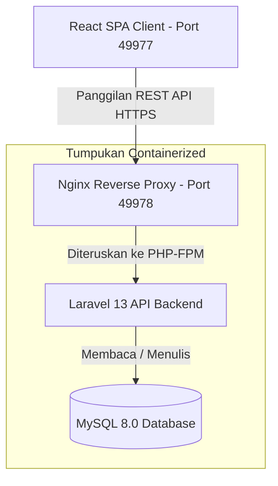
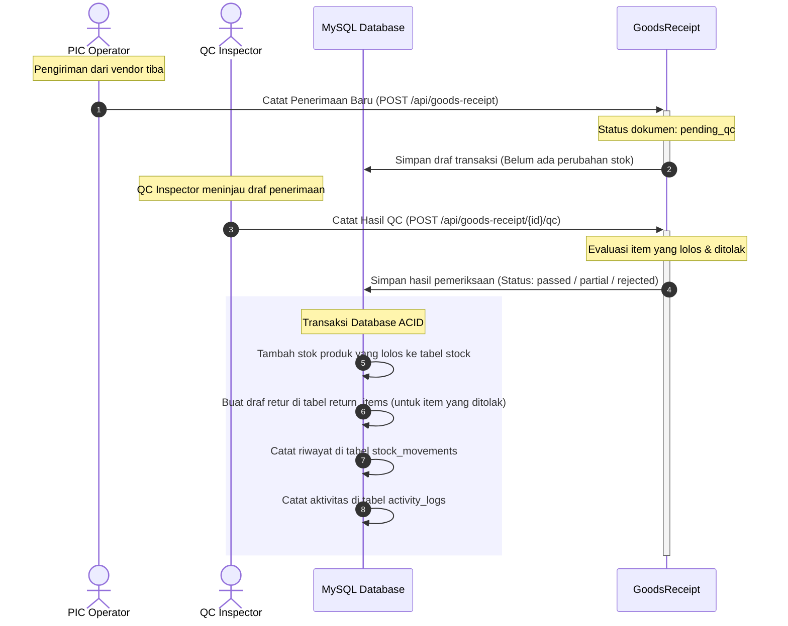
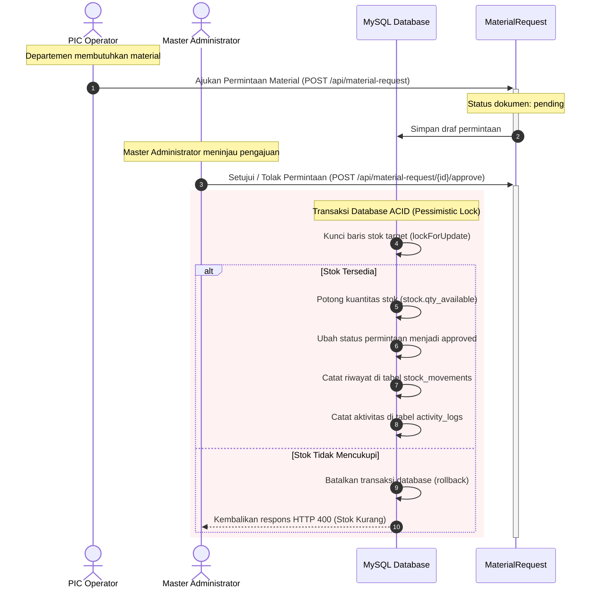
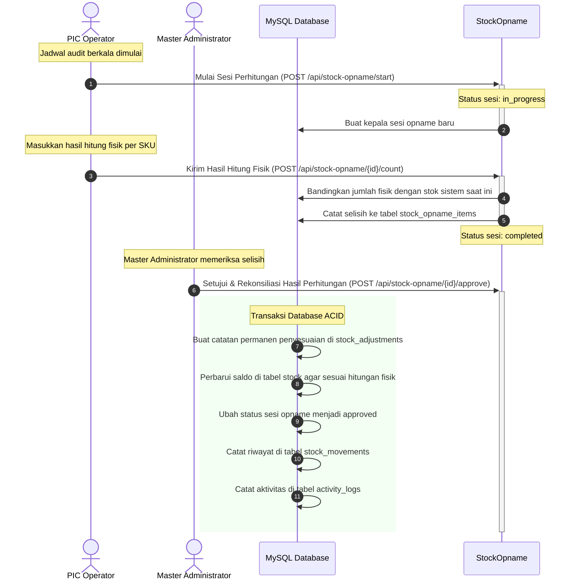
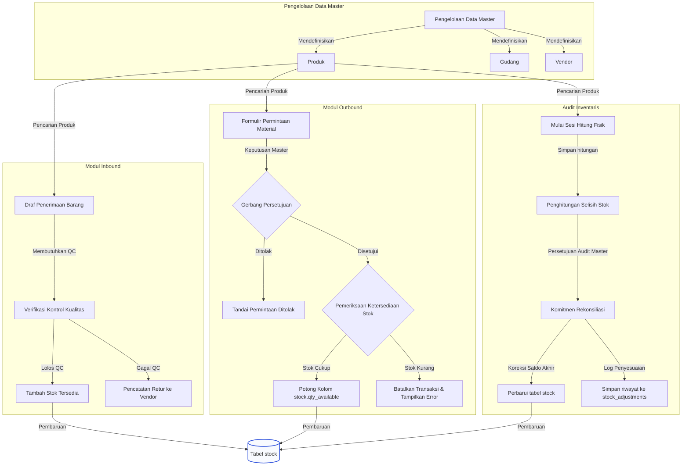

<div align="right">
  <strong>Language Toggle:</strong>
  <a href="./README.md">English</a> |
  <b>Bahasa Indonesia</b>
</div>

# Sistem Manajemen Gudang (Warehouse Management System - WMS)

Sistem Manajemen Gudang (WMS) kelas enterprise yang terintegrasi, dibangun untuk mengoptimalkan operasional gudang, menjaga akurasi stok inventaris secara mutlak, menegakkan standar kualitas produk, dan menyediakan pengawasan administratif yang ketat untuk permintaan material serta audit stock opname.

---

## Ringkasan Sistem

Sistem Manajemen Gudang ini terdiri dari beberapa komponen:
1. **Frontend:** Single Page Application (SPA) modern dan responsif yang dibangun menggunakan React 19, terstruktur di sekitar dashboard metrik, manajemen inbound (barang masuk), permintaan outbound (barang keluar), inspeksi kontrol kualitas (QC), dan modul audit.
2. **Backend:** RESTful API kuat yang dibangun di atas Laravel 13 (PHP 8.3) dengan memanfaatkan Laravel Sanctum untuk manajemen autentikasi berbasis token yang aman, baik secara stateful maupun stateless, serta dilengkapi dengan Kontrol Akses Berbasis Peran (RBAC).
3. **Database:** Instance relasional MySQL 8.0 yang dikonfigurasi untuk menjamin kepatuhan ACID (Atomicity, Consistency, Isolation, Durability) dalam mutasi inventaris frekuensi tinggi dan pencatatan log audit.
4. **Reverse Proxy:** Server web Nginx dalam container yang mengelola aset statis untuk React SPA dan mengarahkan protokol permintaan ke PHP-FPM untuk Laravel API.

---

## Alur Kerja Arsitektur

Orkestrasi container dan alur permintaan sistem secara lengkap diilustrasikan di bawah ini:



---

## Kontrol Akses Berbasis Peran (RBAC)

Sistem menerapkan empat peran administratif yang berbeda untuk menjaga pemisahan wewenang dan keamanan operasional:

1. **Super Admin (Super Administrator):**
   * Hak akses penuh terhadap konfigurasi global dan administrasi sistem.
   * Hak akses eksklusif untuk memeriksa riwayat log aktivitas sistem secara keseluruhan (Audit Logs).
   * Wewenang untuk mengelola akun pengguna lain serta menyetujui atau menolak pendaftaran akun baru.
   * Pengawasan administratif langsung di berbagai gudang.

2. **Master (Administrator):** 
   * Hak akses administratif penuh terhadap master data gudang terkait.
   * Wewenang eksklusif untuk menyetujui atau menolak Permintaan Material (Material Requests).
   * Wewenang eksklusif untuk menyetujui rekonsiliasi stock opname dan mengeksekusi penyesuaian saldo stok akhir di database.
   * Pengawasan penuh terhadap metrik dashboard di semua gudang.

3. **PIC (Operator Gudang):**
   * Bertanggung jawab untuk mencatat pengiriman barang masuk (Goods Receipts).
   * Memulai sesi stock opname dan mencatat hasil perhitungan fisik di lapangan.
   * Mengajukan permintaan keluar material untuk kebutuhan operasional departemen.

4. **QC (Quality Control Inspector):**
   * Bertanggung jawab untuk memeriksa kiriman barang masuk.
   * Mencatat jumlah barang yang lolos atau ditolak pada dokumen Goods Receipts yang berstatus tertunda.
   * Berwenang untuk menulis catatan inspeksi dan membuat draf pengembalian barang (returns).

---

## Alur Bisnis Utama

### 1. Penerimaan Barang Masuk & Gerbang Kontrol Kualitas (QC)
* **Pencatatan Inbound:** Seorang PIC mencatat pengiriman dari vendor menggunakan `POST /api/goods-receipt`. Dokumen dibuat dengan nomor transaksi unik (contoh: `GR-20260530-0001`) dan ditandai dengan status `pending_qc`. Pada tahap ini, saldo stok inventaris belum berubah.
* **Inspeksi QC:** Inspektur QC mengambil dokumen penerimaan yang tertunda dan mencatat hasil pemeriksaan fisik menggunakan `POST /api/goods-receipt/{id}/qc`.
* **Mutasi Stok & Retur:** Transaksi diproses di dalam blok database ACID yang aman:
   * Untuk jumlah barang yang diterima (lolos QC): Stok produk yang sesuai di tabel `stock` akan bertambah.
   * Untuk jumlah barang yang ditolak (gagal QC): Catatan pengembalian otomatis dibuat di tabel `return_items` yang mengarah kembali ke vendor terkait.

### 2. Permintaan Outbound Material Departemen
* **Pengajuan:** Seorang PIC mengajukan permintaan konsumsi material departemen menggunakan `POST /api/material-request`, dengan menyertakan kode permintaan unik (contoh: `MR-20260530-0001`) serta menentukan gudang asal dan departemen tujuan.
* **Gerbang Keputusan Master:** Pengguna dengan peran Master meninjau permintaan tersebut dan memicu endpoint `POST /api/material-request/{id}/approve` atau `POST /api/material-request/{id}/reject`.
* **Eksekusi Transaksi:** Setelah disetujui, sistem mengunci baris stok target menggunakan mekanisme penguncian pesimistis (`lockForUpdate`), memverifikasi ketersediaan stok, dan mengurangi jumlah barang dari kolom `stock.qty_available`. Jika stok tidak mencukupi, transaksi otomatis dibatalkan (rollback) dan mengembalikan respons error HTTP 400 beserta daftar item yang kekurangan stok.

### 3. Audit & Rekonsiliasi Stock Opname
* **Memulai Sesi:** Seorang PIC memulai sesi stock opname untuk gudang tertentu menggunakan `POST /api/stock-opname/start`. Status sesi diatur menjadi `in_progress`.
* **Pencatatan Perhitungan:** PIC menghitung fisik barang di gudang dan mengirimkan datanya menggunakan `POST /api/stock-opname/{id}/count`. Sistem mengambil jumlah stok sistem saat ini dari tabel `stock`, menghitung selisih (`discrepancy = physical_qty - system_qty`), mencatat hasilnya ke `stock_opname_items`, dan mengubah status sesi menjadi `completed` (menunggu peninjauan).
* **Persetujuan Rekonsiliasi Master:** Pengguna Master menyetujui selisih perhitungan tersebut dengan memanggil `POST /api/stock-opname/{id}/approve`. Di dalam transaksi database yang aman, sistem akan:
   * Membuat catatan audit permanen di tabel `stock_adjustments` yang merinci jumlah stok sistem sebelum penyesuaian, jumlah fisik setelah penyesuaian, dan selisihnya.
   * Memperbarui data di tabel `stock` agar sesuai dengan perhitungan fisik lapangan yang telah diverifikasi untuk mengoreksi pembukuan.

---

## Struktur Skema Database

Sistem menggunakan 17 tabel relasional utama, dirancang dengan foreign key cascading yang ketat dan indeks yang dioptimalkan:

### 1. roles
* `role_id` (BIGINT, PK, Auto Increment)
* `role_name` (VARCHAR 50, Unik) - Master, PIC, QC
* `description` (TEXT, Nullable)
* `timestamps`

### 2. warehouses
* `warehouse_id` (BIGINT, PK, Auto Increment)
* `warehouse_name` (VARCHAR 100)
* `address` (TEXT, Nullable)
* `city` (VARCHAR 100, Nullable)
* `pic_id` (BIGINT, FK -> users.id, Nullable)
* `is_active` (BOOLEAN, Default true)
* `timestamps`

### 3. users
* `id` (BIGINT, PK, Auto Increment)
* `role_id` (BIGINT, FK -> roles.role_id)
* `warehouse_id` (BIGINT, FK -> warehouses.warehouse_id, Nullable)
* `name` (VARCHAR 255)
* `email` (VARCHAR 255, Unik)
* `password` (VARCHAR 255)
* `is_active` (BOOLEAN, Default true)
* `remember_token` (VARCHAR 100, Nullable)
* `timestamps`

### 4. vendors
* `vendor_id` (BIGINT, PK, Auto Increment)
* `vendor_name` (VARCHAR 100)
* `contact_person` (VARCHAR 100, Nullable)
* `phone` (VARCHAR 20, Nullable)
* `email` (VARCHAR 100, Nullable)
* `address` (TEXT, Nullable)
* `is_active` (BOOLEAN, Default true)
* `timestamps`

### 5. product_categories
* `category_id` (BIGINT, PK, Auto Increment)
* `category_name` (VARCHAR 100)
* `description` (TEXT, Nullable)
* `timestamps`

### 6. products
* `product_id` (BIGINT, PK, Auto Increment)
* `category_id` (BIGINT, FK -> product_categories.category_id)
* `internal_code` (VARCHAR 50, Unik)
* `product_name` (VARCHAR 100)
* `unit` (VARCHAR 20)
* `description` (TEXT, Nullable)
* `min_stock` (INT, Default 0)
* `is_active` (BOOLEAN, Default true)
* `timestamps`

### 7. vendor_products
* `vendor_product_id` (BIGINT, PK, Auto Increment)
* `vendor_id` (BIGINT, FK -> vendors.vendor_id)
* `product_id` (BIGINT, FK -> products.product_id)
* `vendor_product_code` (VARCHAR 50)
* `vendor_product_name` (VARCHAR 100, Nullable)
* `unit_price` (DECIMAL 15,2, Nullable)
* `is_active` (BOOLEAN, Default true)
* `timestamps`

### 8. departments
* `department_id` (BIGINT, PK, Auto Increment)
* `department_name` (VARCHAR 100)
* `is_active` (BOOLEAN, Default true)
* `timestamps`

### 9. stock
* `stock_id` (BIGINT, PK, Auto Increment)
* `warehouse_id` (BIGINT, FK -> warehouses.warehouse_id)
* `product_id` (BIGINT, FK -> products.product_id)
* `qty_available` (INT, Default 0)
* `qty_reserved` (INT, Default 0)
* `zone` (VARCHAR 10, Nullable)
* `rack` (VARCHAR 10, Nullable)
* `bin` (VARCHAR 10, Nullable)
* `last_updated` (TIMESTAMP, Otomatis)
* `timestamps`
* Kunci Unik: `[warehouse_id, product_id]`

### 10. goods_receipts
* `gr_id` (BIGINT, PK, Auto Increment)
* `gr_number` (VARCHAR 50, Unik)
* `warehouse_id` (BIGINT, FK -> warehouses.warehouse_id)
* `vendor_id` (BIGINT, FK -> vendors.vendor_id)
* `received_by` (BIGINT, FK -> users.id)
* `receipt_date` (DATETIME)
* `receipt_type` (ENUM 'good_receipt', 'pending_order')
* `notes` (TEXT, Nullable)
* `timestamps`

### 11. goods_receipt_items
* `gr_item_id` (BIGINT, PK, Auto Increment)
* `gr_id` (BIGINT, FK -> goods_receipts.gr_id)
* `vendor_product_id` (BIGINT, FK -> vendor_products.vendor_product_id)
* `product_id` (BIGINT, FK -> products.product_id)
* `qty_received` (INT)
* `qty_accepted` (INT, Default 0)
* `qty_rejected` (INT, Default 0)
* `qc_status` (ENUM 'pending', 'passed', 'partial', 'rejected')
* `qc_by` (BIGINT, FK -> users.id, Nullable)
* `qc_date` (DATETIME, Nullable)
* `qc_notes` (TEXT, Nullable)
* `timestamps`

### 12. return_items
* `return_id` (BIGINT, PK, Auto Increment)
* `gr_item_id` (BIGINT, FK -> goods_receipt_items.gr_item_id)
* `product_id` (BIGINT, FK -> products.product_id)
* `vendor_id` (BIGINT, FK -> vendors.vendor_id)
* `qty_returned` (INT)
* `reason` (TEXT, Nullable)
* `return_date` (DATE)
* `returned_by` (BIGINT, FK -> users.id)
* `status` (ENUM 'pending', 'sent', 'acknowledged')
* `timestamps`

### 13. material_requests
* `mr_id` (BIGINT, PK, Auto Increment)
* `mr_number` (VARCHAR 50, Unik)
* `warehouse_id` (BIGINT, FK -> warehouses.warehouse_id)
* `department_id` (BIGINT, FK -> departments.department_id)
* `requested_by` (VARCHAR 100)
* `request_date` (DATETIME)
* `status` (ENUM 'pending', 'approved', 'rejected', 'completed')
* `approved_by` (BIGINT, FK -> users.id, Nullable)
* `approved_date` (DATETIME, Nullable)
* `notes` (TEXT, Nullable)
* `timestamps`

### 14. material_request_items
* `mr_item_id` (BIGINT, PK, Auto Increment)
* `mr_id` (BIGINT, FK -> material_requests.mr_id)
* `product_id` (BIGINT, FK -> products.product_id)
* `qty_requested` (INT)
* `qty_fulfilled` (INT, Default 0)
* `notes` (TEXT, Nullable)
* `timestamps`

### 15. stock_opnames
* `opname_id` (BIGINT, PK, Auto Increment)
* `warehouse_id` (BIGINT, FK -> warehouses.warehouse_id)
* `conducted_by` (BIGINT, FK -> users.id)
* `approved_by` (BIGINT, FK -> users.id, Nullable)
* `start_date` (DATETIME)
* `end_date` (DATETIME, Nullable)
* `status` (ENUM 'draft', 'in_progress', 'completed', 'approved')
* `notes` (TEXT, Nullable)
* `timestamps`

### 16. stock_opname_items
* `opname_item_id` (BIGINT, PK, Auto Increment)
* `opname_id` (BIGINT, FK -> stock_opnames.opname_id)
* `product_id` (BIGINT, FK -> products.product_id)
* `system_qty` (INT)
* `physical_qty` (INT)
* `discrepancy` (INT)
* `notes` (TEXT, Nullable)
* `timestamps`

### 17. stock_adjustments
* `adjustment_id` (BIGINT, PK, Auto Increment)
* `opname_id` (BIGINT, FK -> stock_opnames.opname_id)
* `product_id` (BIGINT, FK -> products.product_id)
* `warehouse_id` (BIGINT, FK -> warehouses.warehouse_id)
* `qty_before` (INT)
* `qty_after` (INT)
* `adjusted_by` (BIGINT, FK -> users.id)
* `adjustment_date` (DATETIME)
* `reason` (TEXT, Nullable)
* `timestamps`

---

## Spesifikasi API Lengkap

Semua permintaan API sistem diawali dengan prefiks `/api`. Rincian endpoint didokumentasikan di bawah ini:

### Autentikasi
* `POST /auth/login` - Menerima payload JSON `{"email": "...", "password": "..."}`. Mengembalikan token Sanctum dan data profil pengguna yang terautentikasi.
* `POST /auth/register` - Mendaftarkan pengguna baru (akses terbatas).
* `POST /auth/logout` - Terproteksi. Mencabut token sesi aktif.
* `GET /auth/profile` - Terproteksi. Mengambil detail sesi pengguna saat ini.

### Dashboard
* `GET /dashboard/summary` - Terproteksi. Mengagregasi metrik inventaris, jumlah tugas yang tertunda, jumlah sesi opname aktif, dan daftar peringatan produk dengan stok kritis di bawah ambang batas minimum.

### Master Data
* `GET /master/warehouses` - Terproteksi. Mencantumkan daftar gudang aktif.
* `GET /master/departments` - Terproteksi. Mencantumkan daftar departemen aktif.
* `GET /master/vendors` - Terproteksi. Mencantumkan daftar vendor aktif.
* `GET /master/categories` - Terproteksi. Mencantumkan kategori produk.
* `GET /master/products` - Terproteksi. Mencantumkan daftar produk beserta kategori masing-masing.

### Goods Receipt & QC
* `GET /goods-receipt` - Terproteksi. Mengambil riwayat dokumen penerimaan barang masuk beserta relasi data gudang, vendor, dan pencatat transaksi.
* `GET /goods-receipt/{id}` - Terproteksi. Menampilkan rincian item barang pada dokumen penerimaan tertentu.
* `POST /goods-receipt` - Terproteksi (Master, PIC). Mengirimkan transaksi penerimaan barang baru dari vendor.
* `POST /goods-receipt/{id}/qc` - Terproteksi (Master, QC). Mencatat hasil kontrol kualitas (QC), memperbarui stok inventaris, dan mencatat retur barang yang gagal QC ke vendor.
* `GET /returns` - Terproteksi. Menampilkan daftar riwayat retur barang ke vendor.

### Permintaan Material (Material Requests)
* `GET /material-request` - Terproteksi. Menampilkan daftar permintaan material keluar dari departemen.
* `GET /material-request/{id}` - Terproteksi. Menampilkan rincian item permintaan material tertentu.
* `POST /material-request` - Terproteksi (Master, PIC). Mengajukan permintaan konsumsi material baru.
* `POST /material-request/{id}/approve` - Terproteksi (Master). Menyetujui permintaan, mengunci baris stok database, memverifikasi kecukupan kuantitas, dan memotong saldo stok.
* `POST /material-request/{id}/reject` - Terproteksi (Master). Menolak permintaan material disertai pengisian alasan penolakan.

### Stock Opname
* `GET /stock-opname` - Terproteksi. Menampilkan daftar sesi audit stock opname gudang.
* `GET /stock-opname/{id}` - Terproteksi. Menampilkan rincian sesi opname dan hasil perhitungan fisik per item.
* `POST /stock-opname/start` - Terproteksi (Master, PIC). Memulai sesi perhitungan fisik baru.
* `POST /stock-opname/{id}/count` - Terproteksi (Master, PIC). Menyimpan hasil perhitungan fisik, memuat stok sistem saat ini, dan menghitung selisih (discrepancy).
* `POST /stock-opname/{id}/approve` - Terproteksi (Master). Menyetujui hasil rekonsiliasi audit, memperbarui saldo pembukuan stok fisik, dan mencatat riwayat penyesuaian.

---

## Alur Pengguna Secara Lengkap (User Flow)

Alur kerja operasional dalam Sistem Manajemen Gudang mencakup tiga proses utama yang melibatkan peran pengguna berbeda dan mutasi status di database relasional.

### 1. Alur Penerimaan Barang Masuk (Vendor ke Rak)



### 2. Alur Pengeluaran Barang (Permintaan Departemen)



### 3. Alur Audit Inventaris (Stock Opname & Rekonsiliasi)



---

## Bagan Alur Fitur & Hubungan Modul

Integrasi tingkat tinggi antara modul inbound, outbound, audit, dan pengelolaan data master digambarkan di bawah ini:



---

## Panduan Menjalankan Aplikasi Secara Rinci (Lintas Platform)

Ekosistem aplikasi ini telah dikemas sepenuhnya menggunakan Docker, sehingga proses inisialisasi berjalan seragam di semua sistem operasi utama. Berikut adalah panduan langkah demi langkah untuk menjalankan aplikasi pada Linux, macOS, dan Windows.

### Persyaratan Utama (Semua Sistem Operasi)
- Docker Desktop (atau Docker Engine dengan Docker Compose versi 2) sudah terpasang.
- Git sudah terpasang.
- Port yang harus terbuka dan bebas dari konflik: `49977` (untuk Frontend) dan `49978` (untuk Backend API).

---

### 1. Menjalankan di Linux (Ubuntu, Debian, Fedora, CentOS)

Sistem operasi Linux memerlukan konfigurasi hak akses berkas yang tepat agar Docker Compose dapat memasang volume lokal dengan benar.

1. **Ekstrak Kode Sumber Aplikasi**:
   Ekstrak arsip ZIP proyek yang disediakan dan masuk ke direktori yang diekstrak:
   ```bash
   unzip wmsmuhamad.zip
   cd wmsmuhamad
   ```

2. **Atur Hak Akses Berkas Script agar Dapat Dieksekusi**:
   ```bash
   chmod +x runapp.sh backend/deploy.sh frontend/deploy.sh
   ```

3. **Mulai Orkestrasi Container**:
   Jalankan skrip inisialisasi gabungan dari folder root:
   ```bash
   ./runapp.sh
   ```

4. **Verifikasi Status Container**:
   Pastikan seluruh container aktif dan berjalan lancar:
   ```bash
   docker ps
   ```

5. **Melihat Aliran Log Kontainer (Penyelesaian Masalah)**:
   Untuk memantau aktivitas logs aplikasi backend secara real-time:
   ```bash
   docker compose -f backend/docker-compose.yml logs -f app
   ```

---

### 2. Menjalankan di macOS (Prosesor Intel dan Apple Silicon M1/M2/M3)

Pengguna macOS disarankan menggunakan Docker Desktop yang secara otomatis menangani emulasi arsitektur x86_64 pada Apple Silicon dengan kinerja optimal.

1. **Jalankan Aplikasi Docker Desktop**:
   Pastikan mesin virtual Docker di macOS Anda telah aktif sepenuhnya.

2. **Ekstrak Kode Sumber Aplikasi**:
   Buka aplikasi Terminal di Mac Anda, ekstrak arsip ZIP proyek yang disediakan, dan masuk ke direktori yang diekstrak:
   ```bash
   unzip wmsmuhamad.zip
   cd wmsmuhamad
   ```

3. **Atur Hak Akses Berkas Script**:
   ```bash
   chmod +x runapp.sh backend/deploy.sh frontend/deploy.sh
   ```

4. **Jalankan Aplikasi**:
   ```bash
   ./runapp.sh
   ```
   Catatan: Pada macOS, apabila muncul pop-up permintaan izin pembacaan folder lokal (Volume Mounting), pilih "Allow" agar Docker diizinkan memetakan kode program ke dalam container.

5. **Verifikasi Akses Layanan**:
   - Buka Browser dan akses React Frontend di: `http://localhost:49977`
   - Buka Browser dan akses Laravel Backend di: `http://localhost:49978`

---

### 3. Menjalankan di Microsoft Windows 10 / 11

Untuk memastikan kompatibilitas penuh dan performa pembacaan berkas (I/O) yang maksimal pada Windows, sangat disarankan menggunakan **WSL2 (Windows Subsystem for Linux)**.

#### Opsi A: Menjalankan Menggunakan WSL2 (Sangat Disarankan)
1. Pastikan fitur **WSL2** telah diaktifkan di Windows Anda dan distribusi Linux (seperti Ubuntu) telah terpasang.
2. Buka Docker Desktop di Windows, masuk ke menu **Settings > General**, lalu pastikan opsi **Use the WSL 2 based engine** telah dicentang.
3. Masuk ke **Settings > Resources > WSL Integration**, lalu aktifkan integrasi untuk Linux Ubuntu Anda.
4. Buka terminal Linux WSL2 (Ubuntu), lalu jalankan perintah berikut:
   ```bash
   unzip wmsmuhamad.zip
   cd wmsmuhamad
   chmod +x runapp.sh backend/deploy.sh frontend/deploy.sh
   ./runapp.sh
   ```

#### Opsi B: Menjalankan Menggunakan Git Bash or PowerShell
1. Pastikan **Docker Desktop** telah aktif di Windows.
2. Buka terminal **Git Bash** (direkomendasikan karena mendukung eksekusi skrip Bash) dan jalankan:
   ```bash
   # Ekstrak arsip ZIP proyek dan masuk ke direktori yang diekstrak:
   cd wmsmuhamad
   ./runapp.sh
   ```
3. Apabila Anda terpaksa menggunakan **PowerShell** murni (yang tidak mendukung jalannya berkas shell `.sh` secara bawaan), Anda harus mengetikkan perintah inisialisasi secara manual sebagai berikut:
   - Masuk ke folder backend dan jalankan:
     ```powershell
     cd backend
     docker compose up -d --build
     docker exec -it wms-backend-app composer install
     docker exec -it wms-backend-app php artisan migrate:fresh --seed
     cd ..
     ```
   - Masuk ke folder frontend dan jalankan:
     ```powershell
     cd frontend
     docker compose up -d --build
     cd ..
     ```

---

## Dokumentasi Proyek

Proyek ini menyediakan dokumentasi komprehensif untuk developer, tim QA, dan stakeholder. Semua dokumen tersedia dalam **Bahasa Inggris** dan **Bahasa Indonesia**.

### Panduan Alur Pengguna & Manual Aplikasi

Panduan langkah demi langkah lengkap untuk setiap role pengguna (Master, PIC, QC) dengan screenshot yang diambil langsung dari aplikasi yang berjalan.

| Bahasa | Dokumen |
|:------:|---------|
| 🇬🇧 Inggris | [documentation/userflowonapp/README.md](./documentation/userflowonapp/README.md) |
| 🇮🇩 Indonesia | [documentation/userflowonapp/README.id.md](./documentation/userflowonapp/README.id.md) |

**Mencakup:** Login/Register, Dashboard, Penerimaan Barang (5 tab), Inspeksi QC, Permintaan Material, Stock Opname, Ikhtisar Stok, CRUD Data Master, Matriks Akses Role, dan 28 screenshot beranotasi.

### Interaksi File & Arsitektur

Dokumentasi teknis yang memetakan bagaimana setiap file sumber berinteraksi dengan file lainnya, dibagi menjadi dua kategori: dependensi modul internal (import lokal) dan interaksi API jaringan (HTTP REST).

| Bahasa | Dokumen |
|:------:|---------|
| 🇬🇧 Inggris | [documentation/fileinteractions/README.md](./documentation/fileinteractions/README.md) |
| 🇮🇩 Indonesia | [documentation/fileinteractions/README.id.md](./documentation/fileinteractions/README.id.md) |

**Sub-dokumen yang disertakan:**

| Topik | 🇬🇧 Inggris | 🇮🇩 Indonesia |
|-------|:----------:|:--------------:|
| Dependensi Modul Internal | [internal_dependencies.md](./documentation/fileinteractions/internal_dependencies.md) | [internal_dependencies.id.md](./documentation/fileinteractions/internal_dependencies.id.md) |
| Interaksi API Jaringan | [network_api_interactions.md](./documentation/fileinteractions/network_api_interactions.md) | [network_api_interactions.id.md](./documentation/fileinteractions/network_api_interactions.id.md) |

**Mencakup:** Rantai entry frontend, service layer, pohon layout/komponen, matriks dependensi 9 halaman, 6 stylesheet, registrasi route backend, 10 controller dengan pemetaan model/helper, 14 relasi model Eloquent, 47 endpoint REST API dengan diagram sequence Mermaid.

### Skrip QA & Testing

| Skrip | Lokasi | Tujuan |
|-------|--------|--------|
| Test Integrasi E2E | [frontend/scripts/comprehensive_test.cjs](./frontend/scripts/comprehensive_test.cjs) | Crawler Puppeteer headless yang mencakup semua route, tab, modal, dan 3 role pengguna (37 langkah test) |
| Tangkapan Screenshot | [scripts/capture_screenshots.js](./scripts/capture_screenshots.js) | Generator screenshot Light Mode otomatis untuk aset dokumentasi |

---

## Kredensial Uji Coba (Sandbox)

Gunakan daftar profil pengguna pra-seeder berikut untuk masuk dan melakukan pengujian peran (seluruh akun menggunakan kata sandi: `password`):

1. **Super Admin (Administrator Sistem)**:
   - **Email**: `admin@wms.com`
   - **Modul yang Dapat Diakses**: Dashboard, Registrasi Pengguna Baru, Pengelolaan Pengguna, Log Audit Sistem.

2. **Master Administrator (Akses Penuh)**:
   - **Email**: `master@wms.com`
   - **Modul yang Dapat Diakses**: Dashboard, Goods Receipt, QC Inspection, Permintaan Material (Persetujuan), Stock Opname (Rekonsiliasi), Ringkasan Stok, Pengelolaan Data Master.

3. **PIC Operator (Operasional Lapangan)**:
   - **Email**: `pic@wms.com`
   - **Modul yang Dapat Diakses**: Goods Receipt (Pencatatan Baru), Permintaan Material (Pengajuan), Stock Opname (Memulai Sesi & Penginputan Hasil), Ringkasan Stok.

4. **Quality Control Inspector (QC Kualitas)**:
   - **Email**: `qc@wms.com`
   - **Modul yang Dapat Diakses**: QC Inspection, Ringkasan Stok.
