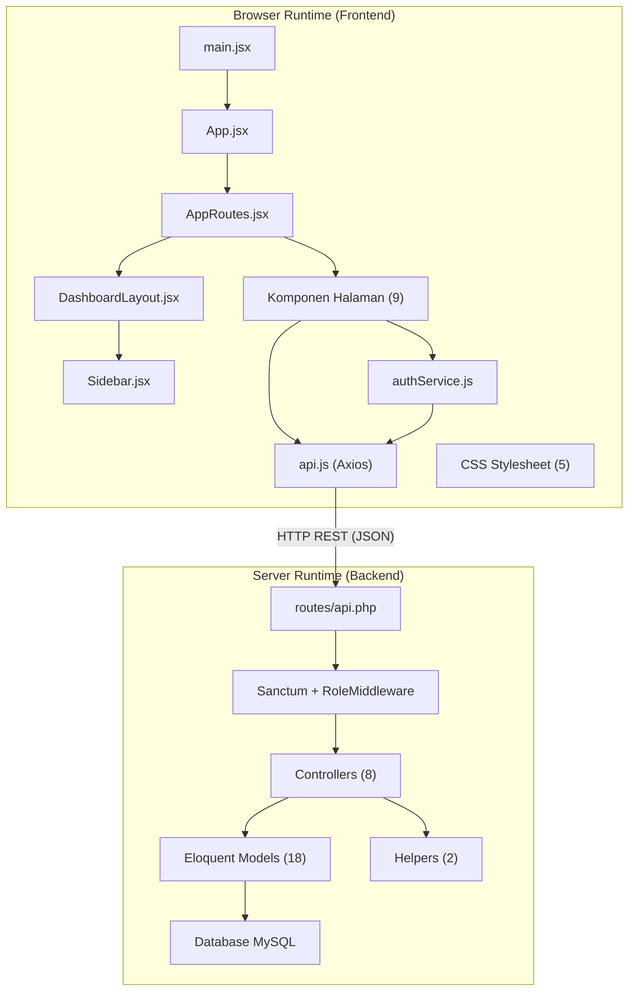

# Dokumentasi Interaksi File — Warehouse Management System

Dokumentasi ini memetakan bagaimana setiap file sumber dalam proyek WMS berinteraksi dengan file lainnya. Dirancang untuk membantu developer baru memahami arsitektur codebase dengan cepat.

Interaksi dikategorikan menjadi dua jenis:

## 📂 Dokumen

| Dokumen | Deskripsi |
|---------|-----------|
| [Dependensi Modul Internal](./internal_dependencies.id.md) | Hubungan `import`/`use` lokal antar file dalam runtime yang sama (tanpa HTTP). Mencakup Frontend (JS/JSX) dan Backend (PHP). |
| [Interaksi API Jaringan](./network_api_interactions.id.md) | Komunikasi berbasis HTTP antara React Frontend dan Laravel Backend melalui endpoint REST API. |

---

## Ikhtisar Arsitektur

---

## Referensi Cepat: Jumlah File

| Layer | Jumlah | Lokasi |
|-------|:------:|--------|
| Halaman Frontend | 9 | `frontend/src/pages/` |
| Service Frontend | 2 | `frontend/src/services/` |
| Layout/Komponen Frontend | 3 | `frontend/src/layout/` + `frontend/src/component/` |
| Stylesheet Frontend | 5 | `frontend/src/styles/` + `frontend/src/` |
| Controller Backend | 8 | `backend/app/Http/Controllers/` |
| Model Backend | 18 | `backend/app/Models/` |
| Helper Backend | 2 | `backend/app/Helpers/` |
| Migrasi Backend | 19 | `backend/database/migrations/` |
| Skrip Test/QA | 2 | `frontend/scripts/` + `scripts/` |
