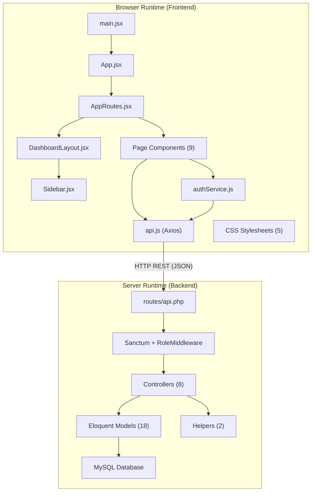

# File Interactions Documentation — Warehouse Management System

This documentation maps how every source file in the WMS project interacts with other files. It is designed to help onboarding developers understand the codebase architecture quickly.

The interactions are categorized into two types:

## 📂 Documents

| Document | Description |
|----------|-------------|
| [Internal Module Dependencies](./internal_dependencies.md) | Local `import`/`use` relationships between files within the same runtime (no HTTP). Covers both Frontend (JS/JSX) and Backend (PHP). |
| [Network API Interactions](./network_api_interactions.md) | HTTP-based communication between the React Frontend and the Laravel Backend via REST API endpoints. |

---

## Architecture Overview

---

## Quick Reference: File Counts

| Layer | Count | Location |
|-------|:-----:|----------|
| Frontend Pages | 9 | `frontend/src/pages/` |
| Frontend Services | 2 | `frontend/src/services/` |
| Frontend Layout/Components | 3 | `frontend/src/layout/` + `frontend/src/component/` |
| Frontend Styles | 5 | `frontend/src/styles/` + `frontend/src/` |
| Backend Controllers | 8 | `backend/app/Http/Controllers/` |
| Backend Models | 18 | `backend/app/Models/` |
| Backend Helpers | 2 | `backend/app/Helpers/` |
| Backend Migrations | 19 | `backend/database/migrations/` |
| Test/QA Scripts | 2 | `frontend/scripts/` + `scripts/` |
