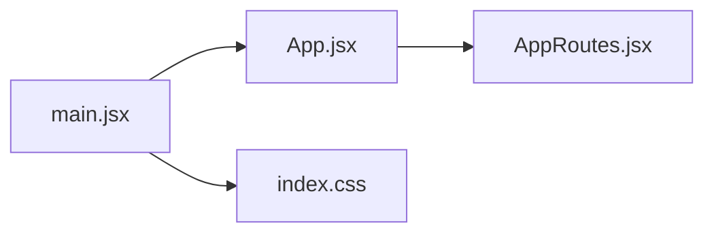
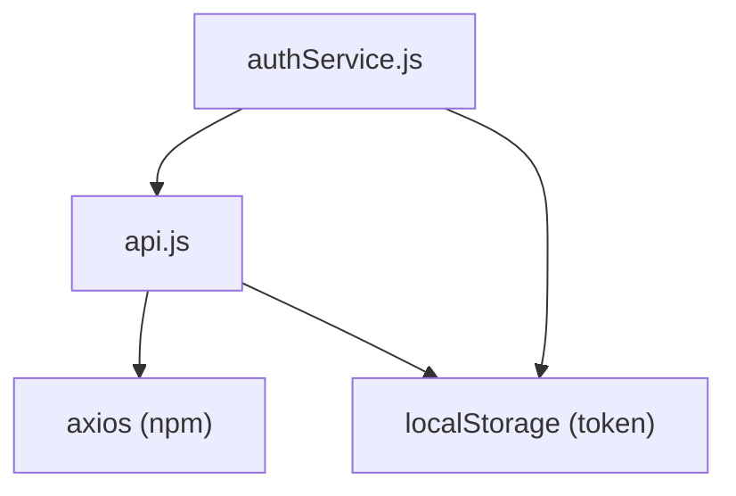

# Dependensi Modul Internal (Import/Use Lokal)

Dokumen ini memetakan semua hubungan file-ke-file secara **lokal** — `import` di JavaScript/JSX dan `use` di PHP. Interaksi ini terjadi **dalam proses runtime yang sama** tanpa panggilan HTTP jaringan.

---

## Daftar Isi

- [Frontend: Rantai Entry Point](#frontend-rantai-entry-point)
- [Frontend: Service Layer](#frontend-service-layer)
- [Frontend: Layout dan Komponen Bersama](#frontend-layout-dan-komponen-bersama)
- [Frontend: Komponen Halaman](#frontend-komponen-halaman)
- [Frontend: Stylesheet](#frontend-stylesheet)
- [Backend: Registrasi Route](#backend-registrasi-route)
- [Backend: Controller → Model/Helper](#backend-controller--modelhelper)
- [Backend: Relasi Model](#backend-relasi-model)
- [Skrip Testing dan QA](#skrip-testing-dan-qa)

---

## Frontend: Rantai Entry Point

Aplikasi melakukan bootstrap melalui rantai import linear:



| File | Import Dari | Fungsi |
|------|------------|--------|
| `main.jsx` | `App.jsx`, `index.css` | Titik mount root React DOM. Membungkus `<App />` dalam `<StrictMode>`. |
| `App.jsx` | `AppRoutes.jsx` | Wrapper minimal yang merender router. |
| `AppRoutes.jsx` | Semua 9 Komponen Halaman, `authService.js` | Mendefinisikan semua `<Route>` dengan guard `<ProtectedRoute>` berbasis role. Menggunakan `authService` untuk memeriksa status autentikasi dan mengarahkan pengguna yang tidak terotorisasi. |

### AppRoutes.jsx — Peta Import Lengkap

```
AppRoutes.jsx
├── react-router-dom        (BrowserRouter, Routes, Route, Navigate)
├── DashboardPage.jsx
├── goodReceipt.jsx
├── qcinspection.jsx
├── MaterialRequest.jsx
├── StockOpname.jsx
├── StockOverview.jsx
├── MasterData.jsx
├── LoginPage.jsx
├── RegisterPage.jsx
└── authService.js          (isAuthenticated, getCurrentUser)
```

---

## Frontend: Service Layer

Dua file service berperan sebagai jembatan antara komponen UI dan sistem eksternal.

### `api.js` — Pabrik HTTP Client Axios

| Import | Ekspor | Fungsi |
|--------|--------|--------|
| `axios` (npm) | `api` (instance Axios terkonfigurasi) | Membuat instance Axios dengan `baseURL` dinamis, header JSON, injeksi Bearer token via request interceptor, dan redirect otomatis 401 via response interceptor. |

**Diimpor oleh:** Setiap komponen halaman, `authService.js`, `RegisterPage.jsx`

### `authService.js` — Pengelola Status Autentikasi

| Import | Ekspor | Fungsi |
|--------|--------|--------|
| `api.js` | objek `authService` | Menyediakan `login()`, `register()`, `logout()`, `getCurrentUser()`, `isAuthenticated()`. Mengelola `localStorage` untuk persistensi token, role, nama, dan warehouse_id. |

**Diimpor oleh:** `AppRoutes.jsx`, `Sidebar.jsx`, `LoginPage.jsx`, `RegisterPage.jsx`, `MaterialRequest.jsx`, `StockOpname.jsx`, `MasterData.jsx`



---

## Frontend: Layout dan Komponen Bersama

### `DashboardLayout.jsx`

| Import | Fungsi |
|--------|--------|
| `Sidebar.jsx` | Membungkus semua halaman terautentikasi dalam layout konsisten dengan navigasi sidebar dan area konten utama. |

**Diimpor oleh:** Semua 7 komponen halaman terproteksi (Dashboard, GR, QC, MR, SO, Stock Overview, Master Data)

### `Sidebar.jsx`

| Import | Fungsi |
|--------|--------|
| `react-router-dom` (Link, useLocation, NavLink) | Link navigasi client-side |
| `lucide-react` (9 ikon) | Ikon menu sidebar |
| `sidebar.css` | Style khusus sidebar |
| `authService.js` | Membaca role user saat ini untuk render menu kondisional; menangani logout |

**Item navigasi yang dirender secara kondisional berdasarkan role:**

| Item Menu | Route | Master | PIC | QC |
|-----------|-------|:------:|:---:|:--:|
| Dashboard | `/dashboard` | ✅ | ❌ | ❌ |
| Penerimaan Barang | `/goods-receipt` | ✅ | ✅ | ❌ |
| Inspeksi QC | `/qc-inspection` | ✅ | ❌ | ✅ |
| Permintaan Material | `/material-request` | ✅ | ✅ | ❌ |
| Stock Opname | `/stock-opname` | ✅ | ✅ | ❌ |
| Ikhtisar Stok | `/stock-overview` | ✅ | ✅ | ✅ |
| Data Master | `/master-data` | ✅ | ❌ | ❌ |

---

## Frontend: Komponen Halaman

Setiap komponen halaman mengikuti pola dependensi yang sama:

```
KomponenHalaman.jsx
├── react (useState, useEffect)
├── DashboardLayout.jsx          ← wrapper layout
├── api.js                       ← panggilan HTTP ke backend
├── authService.js               ← (hanya halaman yang butuh cek role)
└── *.css                        ← style khusus halaman (jika ada)
```

### Matriks Dependensi

| Komponen Halaman | Layout | api.js | authService | CSS | Import Khusus |
|------------------|:------:|:------:|:-----------:|:---:|---------------|
| `DashboardPage.jsx` | ✅ | ✅ | ❌ | `dashboard.css` | `useNavigate` |
| `goodReceipt.jsx` | ✅ | ✅ | ❌ | — | — |
| `qcinspection.jsx` | ✅ | ✅ | ❌ | — | — |
| `MaterialRequest.jsx` | ✅ | ✅ | ✅ | — | — |
| `StockOpname.jsx` | ✅ | ✅ | ✅ | — | — |
| `StockOverview.jsx` | ✅ | ✅ | ❌ | — | — |
| `MasterData.jsx` | ✅ | ✅ | ✅ | — | — |
| `LoginPage.jsx` | ❌ | ❌ | ✅ | `Auth.css` | `useNavigate`, `Link` |
| `RegisterPage.jsx` | ❌ | ✅ | ✅ | `Auth.css` | `useNavigate`, `Link` |

> **Catatan:** `LoginPage` dan `RegisterPage` TIDAK menggunakan `DashboardLayout` karena merupakan halaman publik yang dirender di luar shell terautentikasi.

---

## Frontend: Stylesheet

| Stylesheet | Diimpor Oleh | Cakupan |
|------------|-------------|---------|
| `index.css` | `main.jsx` | Reset global, tipografi, variabel CSS |
| `App.css` | — (legacy, tidak diimpor aktif) | — |
| `Auth.css` | `LoginPage.jsx`, `RegisterPage.jsx` | Styling form Login/Register |
| `dashboard.css` | `DashboardPage.jsx` | Kartu dashboard, tabel, alert |
| `dashboardlayout.css` | `DashboardLayout.jsx` | Area konten utama + grid sidebar |
| `sidebar.css` | `Sidebar.jsx` | Styling menu navigasi |

---

## Backend: Registrasi Route

`routes/api.php` mengimpor dan memetakan semua controller ke endpoint HTTP:

```
routes/api.php
├── AuthController
├── DashboardController
├── GoodsReceiptController
├── MaterialRequestController
├── StockOpnameController
├── MasterDataController
├── PurchaseOrderController
├── PutawayController
├── GoodsIssueController
└── ActivityLogController
```

Rantai middleware: `auth:sanctum` → `role:{Roles}` (via `EnsureUserRole.php`)

---

## Backend: Controller → Model/Helper

Setiap controller mengimpor model Eloquent dan class helper tertentu.

```mermaid
graph TD
    subgraph Controllers
        Auth["AuthController"]
        Dash["DashboardController"]
        GR["GoodsReceiptController"]
        MR["MaterialRequestController"]
        SO["StockOpnameController"]
        MD["MasterDataController"]
    end

    subgraph Models
        User; Role; Warehouse; Product; Stock
        GoodsReceipt; GoodsReceiptItem; ReturnItem
        MaterialRequest_M["MaterialRequest"]; MaterialRequestItem
        StockOpname_M["StockOpname"]; StockOpnameItem; StockAdjustment
        Vendor; VendorProduct; ProductCategory; Department
    end

    subgraph Helpers
        AL["ActivityLogger"]
        SML["StockMovementLogger"]
    end

    Auth --> User & Role & Warehouse
    Dash --> Product & Stock & MaterialRequest_M & StockOpname_M
    GR --> GoodsReceipt & GoodsReceiptItem & ReturnItem & Stock & VendorProduct & AL & SML
    MR --> MaterialRequest_M & MaterialRequestItem & Stock & AL
    SO --> Stock & StockOpname_M & StockOpnameItem & StockAdjustment & AL & SML
    MD --> Warehouse & Department & Vendor & ProductCategory & Product
```



### Tabel Dependensi Controller

| Controller | Model yang Digunakan | Helper yang Digunakan |
|------------|---------------------|----------------------|
| `AuthController` | User, Role, Warehouse | — |
| `DashboardController` | Product, Stock, MaterialRequest, StockOpname | — |
| `GoodsReceiptController` | GoodsReceipt, GoodsReceiptItem, ReturnItem, Stock, VendorProduct | ActivityLogger, StockMovementLogger |
| `MaterialRequestController` | MaterialRequest, MaterialRequestItem, Stock | ActivityLogger |
| `StockOpnameController` | Stock, StockOpname, StockOpnameItem, StockAdjustment | ActivityLogger, StockMovementLogger |
| `MasterDataController` | Warehouse, Department, Vendor, ProductCategory, Product | — |
| `PurchaseOrderController` | PurchaseOrder, PurchaseOrderItem | — |
| `PutawayController` | Putaway | — |
| `GoodsIssueController` | GoodsIssue, GoodsIssueItem | — |
| `ActivityLogController` | ActivityLog, StockMovement | — |

---

## Backend: Relasi Model

| Model | Belongs To (Milik) | Has Many (Memiliki Banyak) |
|-------|-------------------|---------------------------|
| `User` | Role, Warehouse | — |
| `GoodsReceipt` | User (PIC), Vendor, Warehouse | GoodsReceiptItem, ReturnItem |
| `GoodsReceiptItem` | GoodsReceipt, Product | — |
| `MaterialRequest` | User, Department, Warehouse | MaterialRequestItem |
| `MaterialRequestItem` | MaterialRequest, Product | — |
| `StockOpname` | Warehouse, User (pelaksana), User (pemberi persetujuan) | StockOpnameItem |
| `StockOpnameItem` | StockOpname, Product | — |
| `Stock` | Product, Warehouse | — |
| `Product` | ProductCategory | Stock, VendorProduct |
| `Vendor` | — | VendorProduct |
| `VendorProduct` | Vendor, Product | — |
| `Warehouse` | — | User, Stock, StockOpname |
| `Department` | — | MaterialRequest |
| `PurchaseOrder` | Vendor, Warehouse | PurchaseOrderItem |

---

## Skrip Testing dan QA

| Skrip | Lokasi | Import/Menggunakan |
|-------|--------|-------------------|
| `comprehensive_test.cjs` | `frontend/scripts/` | `puppeteer` (npm), `path`, `fs` — Crawler E2E headless browser |
| `capture_screenshots.js` | `scripts/` | `puppeteer` (npm), `path`, `fs` — Tangkapan screenshot otomatis |

Kedua skrip adalah proses Node.js mandiri yang berinteraksi dengan aplikasi yang berjalan via HTTP (Puppeteer menavigasi ke `localhost:49977`).
