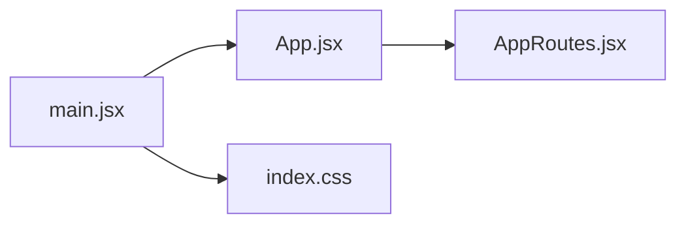
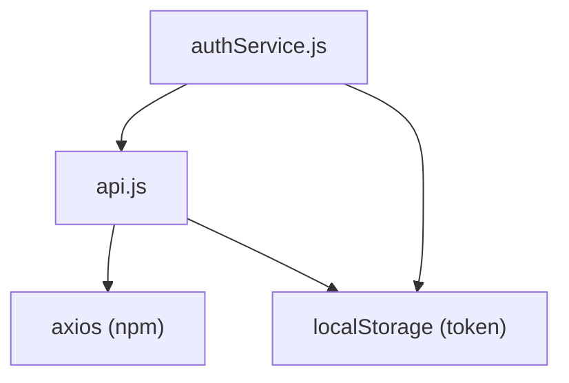

# Internal Module Dependencies (Local Import/Use)

This document maps all **local** file-to-file relationships — `import` in JavaScript/JSX and `use` in PHP. These interactions happen **within the same runtime process** without any HTTP network call.

---

## Table of Contents

- [Frontend: Entry Point Chain](#frontend-entry-point-chain)
- [Frontend: Service Layer](#frontend-service-layer)
- [Frontend: Layout & Shared Components](#frontend-layout--shared-components)
- [Frontend: Page Components](#frontend-page-components)
- [Frontend: Stylesheets](#frontend-stylesheets)
- [Backend: Route Registration](#backend-route-registration)
- [Backend: Controllers → Models/Helpers](#backend-controllers--modelshelpers)
- [Backend: Model Relationships](#backend-model-relationships)
- [Testing & QA Scripts](#testing--qa-scripts)

---

## Frontend: Entry Point Chain

The application bootstraps through a linear chain of imports:



| File | Imports From | Purpose |
|------|-------------|---------|
| `main.jsx` | `App.jsx`, `index.css` | React DOM root mount point. Wraps `<App />` in `<StrictMode>`. |
| `App.jsx` | `AppRoutes.jsx` | Minimal wrapper that renders the router. |
| `AppRoutes.jsx` | All 9 Page Components, `authService.js` | Defines all `<Route>` definitions with role-based `<ProtectedRoute>` guards. Uses `authService` to check authentication state and redirect unauthorized users. |

### AppRoutes.jsx — Complete Import Map

```
AppRoutes.jsx
├── react-router-dom        (BrowserRouter, Routes, Route, Navigate)
├── DashboardPage.jsx
├── goodReceipt.jsx
├── qcinspection.jsx
├── MaterialRequest.jsx
├── StockOpname.jsx
├── StockOverview.jsx
├── MasterData.jsx
├── LoginPage.jsx
├── RegisterPage.jsx
└── authService.js          (isAuthenticated, getCurrentUser)
```

---

## Frontend: Service Layer

Two service files act as the bridge between UI components and external systems.

### `api.js` — Axios HTTP Client Factory

| Imports | Exports | Purpose |
|---------|---------|---------|
| `axios` (npm) | `api` (configured Axios instance) | Creates a pre-configured Axios instance with dynamic `baseURL`, JSON headers, Bearer token injection via request interceptor, and automatic 401 redirect via response interceptor. |

**Imported by:** Every page component, `authService.js`, `RegisterPage.jsx`

### `authService.js` — Authentication State Manager

| Imports | Exports | Purpose |
|---------|---------|---------|
| `api.js` | `authService` object | Provides `login()`, `register()`, `logout()`, `getCurrentUser()`, `isAuthenticated()`. Manages `localStorage` for token, role, name, and warehouse_id persistence. |

**Imported by:** `AppRoutes.jsx`, `Sidebar.jsx`, `LoginPage.jsx`, `RegisterPage.jsx`, `MaterialRequest.jsx`, `StockOpname.jsx`, `MasterData.jsx`



---

## Frontend: Layout & Shared Components

### `DashboardLayout.jsx`

| Imports | Purpose |
|---------|---------|
| `Sidebar.jsx` | Wraps all authenticated pages in a consistent layout with sidebar navigation and a main content area. |

**Imported by:** All 7 protected page components (Dashboard, GR, QC, MR, SO, Stock Overview, Master Data)

### `Sidebar.jsx`

| Imports | Purpose |
|---------|---------|
| `react-router-dom` (Link, useLocation, NavLink) | Client-side navigation links |
| `lucide-react` (9 icons) | Sidebar menu icons |
| `sidebar.css` | Sidebar-specific styles |
| `authService.js` | Read current user role for conditional menu rendering; handle logout |

**Navigation items rendered conditionally by role:**

| Menu Item | Route | Master | PIC | QC |
|-----------|-------|:------:|:---:|:--:|
| Dashboard | `/dashboard` | ✅ | ❌ | ❌ |
| Goods Receipt | `/goods-receipt` | ✅ | ✅ | ❌ |
| QC Inspection | `/qc-inspection` | ✅ | ❌ | ✅ |
| Material Request | `/material-request` | ✅ | ✅ | ❌ |
| Stock Opname | `/stock-opname` | ✅ | ✅ | ❌ |
| Stock Overview | `/stock-overview` | ✅ | ✅ | ✅ |
| Master Data | `/master-data` | ✅ | ❌ | ❌ |

---

## Frontend: Page Components

Each page component follows the same dependency pattern:

```
PageComponent.jsx
├── react (useState, useEffect)
├── DashboardLayout.jsx          ← layout wrapper
├── api.js                       ← HTTP calls to backend
├── authService.js               ← (only pages needing role checks)
└── *.css                        ← page-specific styles (if any)
```

### Dependency Matrix

| Page Component | Layout | api.js | authService | CSS | Special Imports |
|----------------|:------:|:------:|:-----------:|:---:|----------------|
| `DashboardPage.jsx` | ✅ | ✅ | ❌ | `dashboard.css` | `useNavigate` |
| `goodReceipt.jsx` | ✅ | ✅ | ❌ | — | — |
| `qcinspection.jsx` | ✅ | ✅ | ❌ | — | — |
| `MaterialRequest.jsx` | ✅ | ✅ | ✅ | — | — |
| `StockOpname.jsx` | ✅ | ✅ | ✅ | — | — |
| `StockOverview.jsx` | ✅ | ✅ | ❌ | — | — |
| `MasterData.jsx` | ✅ | ✅ | ✅ | — | — |
| `LoginPage.jsx` | ❌ | ❌ | ✅ | `Auth.css` | `useNavigate`, `Link` |
| `RegisterPage.jsx` | ❌ | ✅ | ✅ | `Auth.css` | `useNavigate`, `Link` |

> **Note:** `LoginPage` and `RegisterPage` do NOT use `DashboardLayout` because they are public pages rendered outside the authenticated shell.

---

## Frontend: Stylesheets

| Stylesheet | Imported By | Scope |
|------------|------------|-------|
| `index.css` | `main.jsx` | Global reset, typography, CSS variables |
| `App.css` | — (legacy, not actively imported) | — |
| `Auth.css` | `LoginPage.jsx`, `RegisterPage.jsx` | Login/Register form styling |
| `dashboard.css` | `DashboardPage.jsx` | Dashboard cards, tables, alerts |
| `dashboardlayout.css` | `DashboardLayout.jsx` | Main content area + sidebar grid |
| `sidebar.css` | `Sidebar.jsx` | Navigation menu styling |

---

## Backend: Route Registration

`routes/api.php` imports and maps all controllers to HTTP endpoints:

```
routes/api.php
├── AuthController
├── DashboardController
├── GoodsReceiptController
├── MaterialRequestController
├── StockOpnameController
├── MasterDataController
├── PurchaseOrderController
├── PutawayController
├── GoodsIssueController
└── ActivityLogController
```

Middleware chain: `auth:sanctum` → `role:{Roles}` (via `EnsureUserRole.php`)

---

## Backend: Controllers → Models/Helpers

Each controller imports specific Eloquent models and helper classes.

```mermaid
graph TD
    subgraph Controllers
        Auth["AuthController"]
        Dash["DashboardController"]
        GR["GoodsReceiptController"]
        MR["MaterialRequestController"]
        SO["StockOpnameController"]
        MD["MasterDataController"]
    end

    subgraph Models
        User; Role; Warehouse; Product; Stock
        GoodsReceipt; GoodsReceiptItem; ReturnItem
        MaterialRequest_M["MaterialRequest"]; MaterialRequestItem
        StockOpname_M["StockOpname"]; StockOpnameItem; StockAdjustment
        Vendor; VendorProduct; ProductCategory; Department
    end

    subgraph Helpers
        AL["ActivityLogger"]
        SML["StockMovementLogger"]
    end

    Auth --> User & Role & Warehouse
    Dash --> Product & Stock & MaterialRequest_M & StockOpname_M
    GR --> GoodsReceipt & GoodsReceiptItem & ReturnItem & Stock & VendorProduct & AL & SML
    MR --> MaterialRequest_M & MaterialRequestItem & Stock & AL
    SO --> Stock & StockOpname_M & StockOpnameItem & StockAdjustment & AL & SML
    MD --> Warehouse & Department & Vendor & ProductCategory & Product
```



### Controller Dependency Table

| Controller | Models Used | Helpers Used |
|------------|------------|-------------|
| `AuthController` | User, Role, Warehouse | — |
| `DashboardController` | Product, Stock, MaterialRequest, StockOpname | — |
| `GoodsReceiptController` | GoodsReceipt, GoodsReceiptItem, ReturnItem, Stock, VendorProduct | ActivityLogger, StockMovementLogger |
| `MaterialRequestController` | MaterialRequest, MaterialRequestItem, Stock | ActivityLogger |
| `StockOpnameController` | Stock, StockOpname, StockOpnameItem, StockAdjustment | ActivityLogger, StockMovementLogger |
| `MasterDataController` | Warehouse, Department, Vendor, ProductCategory, Product | — |
| `PurchaseOrderController` | PurchaseOrder, PurchaseOrderItem | — |
| `PutawayController` | Putaway | — |
| `GoodsIssueController` | GoodsIssue, GoodsIssueItem | — |
| `ActivityLogController` | ActivityLog, StockMovement | — |

---

## Backend: Model Relationships

| Model | Belongs To | Has Many |
|-------|-----------|----------|
| `User` | Role, Warehouse | — |
| `GoodsReceipt` | User (PIC), Vendor, Warehouse | GoodsReceiptItem, ReturnItem |
| `GoodsReceiptItem` | GoodsReceipt, Product | — |
| `MaterialRequest` | User, Department, Warehouse | MaterialRequestItem |
| `MaterialRequestItem` | MaterialRequest, Product | — |
| `StockOpname` | Warehouse, User (conductor), User (approver) | StockOpnameItem |
| `StockOpnameItem` | StockOpname, Product | — |
| `Stock` | Product, Warehouse | — |
| `Product` | ProductCategory | Stock, VendorProduct |
| `Vendor` | — | VendorProduct |
| `VendorProduct` | Vendor, Product | — |
| `Warehouse` | — | User, Stock, StockOpname |
| `Department` | — | MaterialRequest |
| `PurchaseOrder` | Vendor, Warehouse | PurchaseOrderItem |

---

## Testing & QA Scripts

| Script | Location | Imports/Uses |
|--------|----------|-------------|
| `comprehensive_test.cjs` | `frontend/scripts/` | `puppeteer` (npm), `path`, `fs` — Headless browser E2E crawler |
| `capture_screenshots.js` | `scripts/` | `puppeteer` (npm), `path`, `fs` — Automated screenshot capture |

Both scripts are standalone Node.js processes that interact with the running application via HTTP (Puppeteer navigates to `localhost:49977`).
