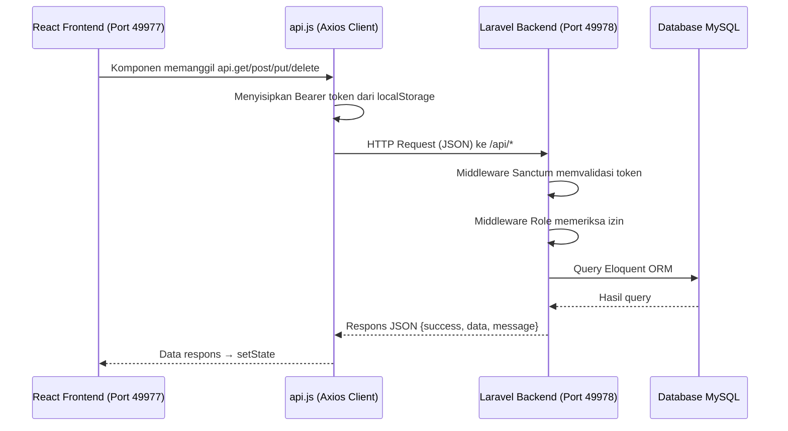
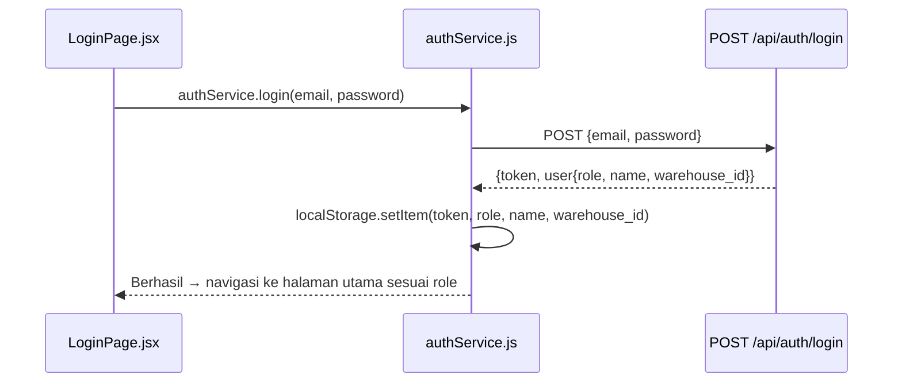
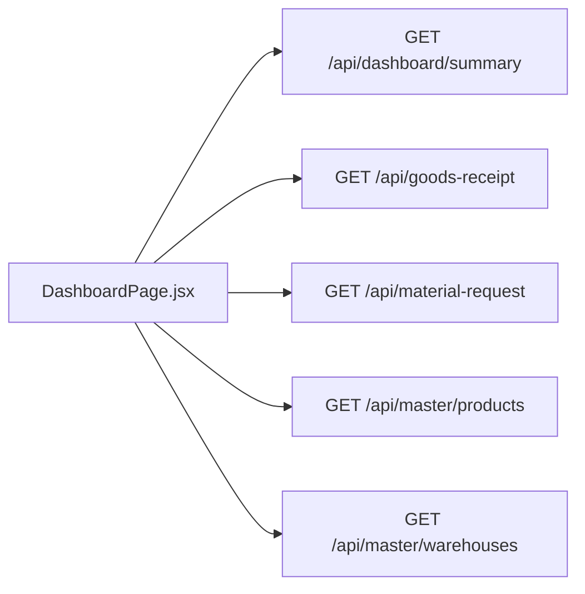
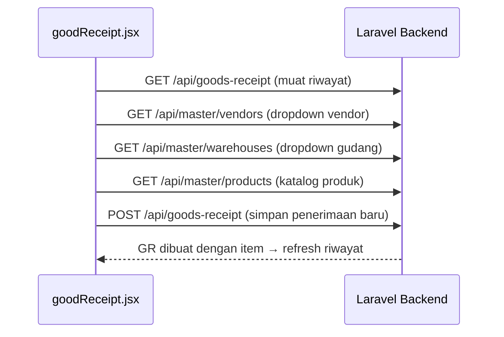
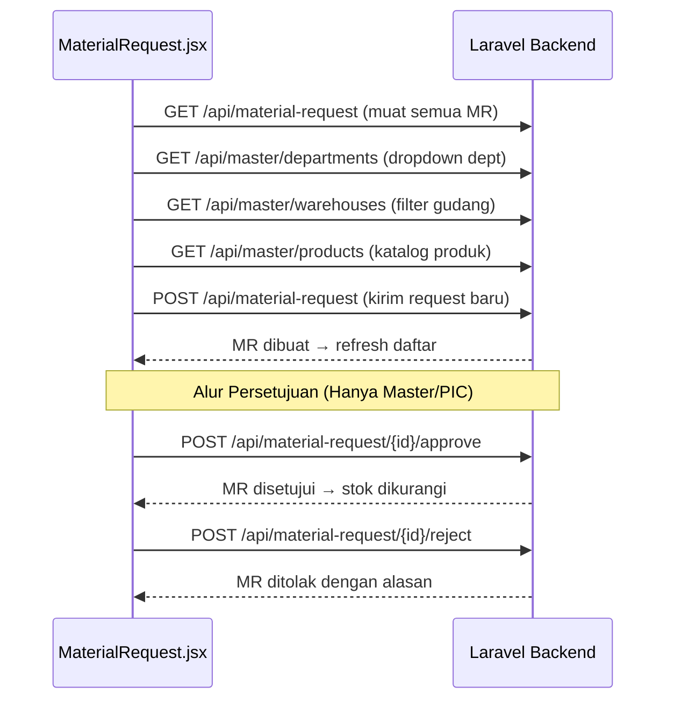
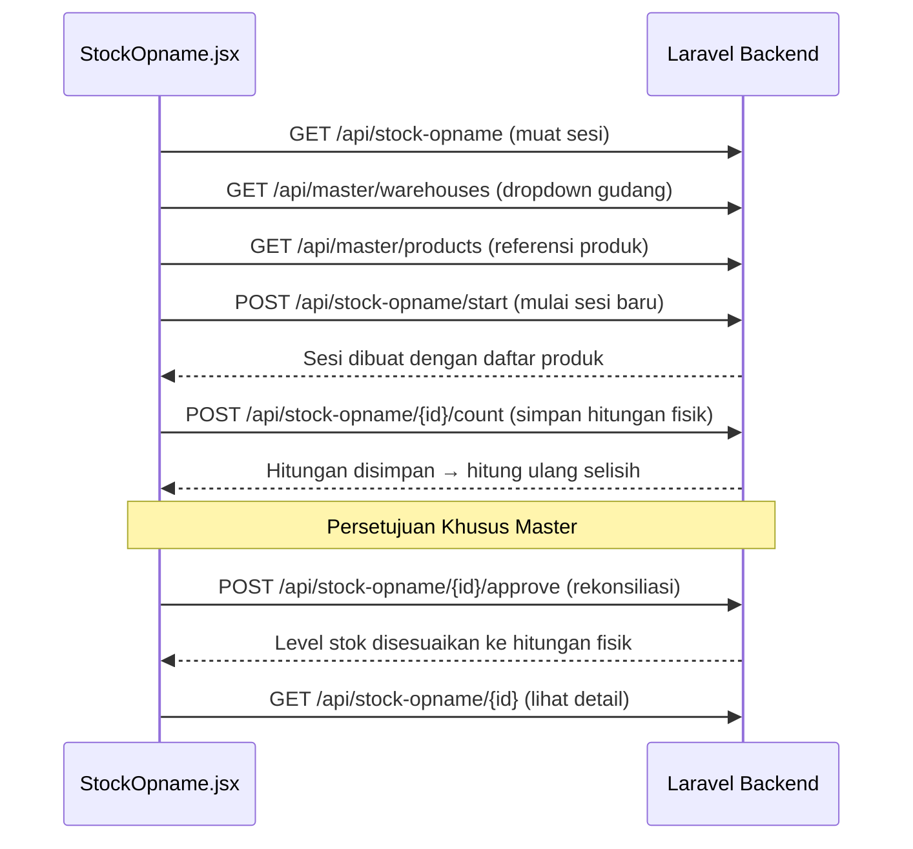

# Interaksi API Jaringan (HTTP REST)

Dokumen ini memetakan semua interaksi **berbasis HTTP** antara React Frontend dan Laravel Backend. Setiap panggilan yang tercantum di sini melewati batas jaringan melalui Axios client (`api.js`) menuju Laravel API (`routes/api.php`).

---

## Daftar Isi

- [Arsitektur Komunikasi](#arsitektur-komunikasi)
- [Alur Autentikasi](#alur-autentikasi)
- [Dashboard](#dashboard)
- [CRUD Data Master](#crud-data-master)
- [Penerimaan Barang dan Inspeksi QC](#penerimaan-barang-dan-inspeksi-qc)
- [Permintaan Material](#permintaan-material)
- [Stock Opname](#stock-opname)
- [Ikhtisar Stok](#ikhtisar-stok)
- [Registri Endpoint API Lengkap](#registri-endpoint-api-lengkap)

---

## Arsitektur Komunikasi

**Base URL:**
- Server Dev Frontend: `http://localhost:49977`
- Server API Backend: `http://localhost:49978/api`

**Autentikasi:** Laravel Sanctum (Bearer Token di header `Authorization`)

**Format Request/Response:** Semua payload menggunakan `Content-Type: application/json`

---

## Alur Autentikasi

### Login (`LoginPage.jsx` → `AuthController@login`)

| File Frontend | Method | Endpoint Backend | Method Controller | Auth |
|--------------|--------|-----------------|-------------------|:----:|
| `LoginPage.jsx` → `authService.login()` | `POST` | `/api/auth/login` | `AuthController@login` | Publik |
| `RegisterPage.jsx` → `authService.register()` | `POST` | `/api/auth/register` | `AuthController@register` | Publik |
| `Sidebar.jsx` → `authService.logout()` | `POST` | `/api/auth/logout` | `AuthController@logout` | 🔒 |

### Registrasi — Pengambilan Gudang Dinamis

| File Frontend | Method | Endpoint Backend | Tujuan |
|--------------|--------|-----------------|--------|
| `RegisterPage.jsx` | `GET` | `/api/master/warehouses` | Mengisi dropdown gudang di form registrasi |

---

## Dashboard

### `DashboardPage.jsx` → Beberapa Endpoint

Halaman Dashboard menembakkan **5 panggilan API paralel** saat dimuat untuk mengisi semua panel:

| Method | Endpoint Backend | Controller | Data yang Dikembalikan | Panel UI |
|--------|-----------------|-----------|----------------------|----------|
| `GET` | `/api/dashboard/summary` | `DashboardController@summary` | Total SKU, jumlah stok rendah, MR tertunda, QC tertunda | Kartu Ringkasan |
| `GET` | `/api/goods-receipt` | `GoodsReceiptController@index` | Semua record GR dengan item | Tabel GR Terbaru |
| `GET` | `/api/material-request` | `MaterialRequestController@index` | Semua record MR dengan item | Tabel MR Tertunda |
| `GET` | `/api/master/products` | `MasterDataController@products` | Semua produk dengan level stok | Panel Peringatan Stok Rendah |
| `GET` | `/api/master/warehouses` | `MasterDataController@warehouses` | Semua gudang | Dropdown Filter Gudang Global |

---

## CRUD Data Master

### `MasterData.jsx` → `MasterDataController`

Halaman ini mengelola 5 tipe entitas melalui antarmuka tab yang terintegrasi. Semua operasi CRUD mengikuti pola REST yang sama:

| Entitas | List (GET) | Buat (POST) | Ubah (PUT) | Hapus (DELETE) |
|---------|-----------|-------------|------------|----------------|
| Produk | `/api/master/products` | `/api/master/products` | `/api/master/products/{id}` | `/api/master/products/{id}` |
| Vendor | `/api/master/vendors` | `/api/master/vendors` | `/api/master/vendors/{id}` | `/api/master/vendors/{id}` |
| Gudang | `/api/master/warehouses` | `/api/master/warehouses` | `/api/master/warehouses/{id}` | `/api/master/warehouses/{id}` |
| Departemen | `/api/master/departments` | `/api/master/departments` | `/api/master/departments/{id}` | `/api/master/departments/{id}` |
| Kategori | `/api/master/categories` | — | — | — |

> **Catatan:** Kategori adalah data referensi read-only; User dikelola melalui endpoint Auth.

---

## Penerimaan Barang dan Inspeksi QC

### `goodReceipt.jsx` → `GoodsReceiptController`

| Method | Endpoint Backend | Method Controller | Guard Role | Tujuan |
|--------|-----------------|-------------------|:----------:|--------|
| `GET` | `/api/goods-receipt` | `index` | 🔒 Semua | Muat semua riwayat GR dengan item |
| `GET` | `/api/goods-receipt/{id}` | `show` | 🔒 Semua | Muat detail satu GR |
| `POST` | `/api/goods-receipt` | `store` | 🔒 Master, PIC | Buat penerimaan barang baru dengan item |
| `GET` | `/api/returns` | `returnsList` | 🔒 Semua | Muat daftar item retur |

### `qcinspection.jsx` → `GoodsReceiptController@recordQC`

| Method | Endpoint Backend | Method Controller | Guard Role | Tujuan |
|--------|-----------------|-------------------|:----------:|--------|
| `GET` | `/api/goods-receipt` | `index` | 🔒 Semua | Muat GR yang menunggu inspeksi QC |
| `POST` | `/api/goods-receipt/{id}/qc` | `recordQC` | 🔒 Master, QC | Kirim hasil QC (qty diterima/ditolak per item) |

**Efek Samping Pengiriman QC:**
- Memperbarui kuantitas `GoodsReceiptItem` (diterima, ditolak)
- Mengubah tabel `Stock` (menambah qty yang diterima ke stok tersedia)
- Mencatat aktivitas via `ActivityLogger`
- Mencatat pergerakan stok via `StockMovementLogger`

---

## Permintaan Material

### `MaterialRequest.jsx` → `MaterialRequestController`

| Method | Endpoint Backend | Method Controller | Guard Role | Tujuan |
|--------|-----------------|-------------------|:----------:|--------|
| `GET` | `/api/material-request` | `index` | 🔒 Semua | Muat semua record MR |
| `GET` | `/api/material-request/{id}` | `show` | 🔒 Semua | Muat detail satu MR |
| `POST` | `/api/material-request` | `store` | 🔒 Master, PIC | Buat permintaan material baru |
| `POST` | `/api/material-request/{id}/approve` | `approve` | 🔒 Master, PIC | Setujui MR dan kurangi stok |
| `POST` | `/api/material-request/{id}/reject` | `reject` | 🔒 Master, PIC | Tolak MR dengan alasan |

**Efek Samping Persetujuan:**
- Mengurangi kuantitas yang disetujui dari tabel `Stock`
- Mencatat aktivitas via `ActivityLogger`

---

## Stock Opname

### `StockOpname.jsx` → `StockOpnameController`

| Method | Endpoint Backend | Method Controller | Guard Role | Tujuan |
|--------|-----------------|-------------------|:----------:|--------|
| `GET` | `/api/stock-opname` | `index` | 🔒 Semua | Muat semua sesi opname |
| `GET` | `/api/stock-opname/{id}` | `show` | 🔒 Semua | Muat detail sesi dengan item |
| `POST` | `/api/stock-opname/start` | `start` | 🔒 Master, PIC | Mulai sesi penghitungan baru |
| `POST` | `/api/stock-opname/{id}/count` | `saveCounts` | 🔒 Master, PIC | Simpan entri hitungan fisik |
| `POST` | `/api/stock-opname/{id}/approve` | `approve` | 🔒 Master | Rekonsiliasi selisih dan sesuaikan stok |

**Efek Samping Persetujuan:**
- Menyesuaikan kuantitas tabel `Stock` agar cocok dengan hitungan fisik
- Membuat record `StockAdjustment` untuk jejak audit
- Mencatat aktivitas via `ActivityLogger`
- Mencatat pergerakan stok via `StockMovementLogger`

---

## Ikhtisar Stok

### `StockOverview.jsx` — Hanya Baca (Read-Only)

| Method | Endpoint Backend | Method Controller | Tujuan |
|--------|-----------------|-------------------|--------|
| `GET` | `/api/master/products` | `MasterDataController@products` | Muat semua produk dengan level stok |
| `GET` | `/api/master/categories` | `MasterDataController@categories` | Muat kategori untuk dropdown filter |

> Ikhtisar Stok tidak menulis data apapun. Ini adalah tampilan read-only murni yang menggunakan ulang endpoint data master.

---

## Registri Endpoint API Lengkap

Semua endpoint HTTP dalam sistem, diurutkan berdasarkan path URL:

| # | Method | Endpoint | Controller | Guard Role | Digunakan Oleh (Frontend) |
|:-:|--------|----------|-----------|:----------:|--------------------------|
| 1 | `POST` | `/api/auth/login` | `AuthController@login` | Publik | `LoginPage.jsx` |
| 2 | `POST` | `/api/auth/register` | `AuthController@register` | Publik | `RegisterPage.jsx` |
| 3 | `POST` | `/api/auth/logout` | `AuthController@logout` | 🔒 Semua | `Sidebar.jsx` |
| 4 | `GET` | `/api/auth/profile` | `AuthController@profile` | 🔒 Semua | — |
| 5 | `GET` | `/api/dashboard/summary` | `DashboardController@summary` | 🔒 Semua | `DashboardPage.jsx` |
| 6 | `GET` | `/api/master/warehouses` | `MasterDataController@warehouses` | 🔒 Semua | Dashboard, GR, MR, SO, MasterData, Register |
| 7 | `POST` | `/api/master/warehouses` | `MasterDataController@storeWarehouse` | 🔒 Semua | `MasterData.jsx` |
| 8 | `PUT` | `/api/master/warehouses/{id}` | `MasterDataController@updateWarehouse` | 🔒 Semua | `MasterData.jsx` |
| 9 | `DELETE` | `/api/master/warehouses/{id}` | `MasterDataController@destroyWarehouse` | 🔒 Semua | `MasterData.jsx` |
| 10 | `GET` | `/api/master/departments` | `MasterDataController@departments` | 🔒 Semua | MR, MasterData |
| 11 | `POST` | `/api/master/departments` | `MasterDataController@storeDepartment` | 🔒 Semua | `MasterData.jsx` |
| 12 | `PUT` | `/api/master/departments/{id}` | `MasterDataController@updateDepartment` | 🔒 Semua | `MasterData.jsx` |
| 13 | `DELETE` | `/api/master/departments/{id}` | `MasterDataController@destroyDepartment` | 🔒 Semua | `MasterData.jsx` |
| 14 | `GET` | `/api/master/vendors` | `MasterDataController@vendors` | 🔒 Semua | GR, MasterData |
| 15 | `POST` | `/api/master/vendors` | `MasterDataController@storeVendor` | 🔒 Semua | `MasterData.jsx` |
| 16 | `PUT` | `/api/master/vendors/{id}` | `MasterDataController@updateVendor` | 🔒 Semua | `MasterData.jsx` |
| 17 | `DELETE` | `/api/master/vendors/{id}` | `MasterDataController@destroyVendor` | 🔒 Semua | `MasterData.jsx` |
| 18 | `GET` | `/api/master/categories` | `MasterDataController@categories` | 🔒 Semua | MasterData, StockOverview |
| 19 | `GET` | `/api/master/products` | `MasterDataController@products` | 🔒 Semua | Dashboard, GR, MR, SO, StockOverview, MasterData |
| 20 | `POST` | `/api/master/products` | `MasterDataController@storeProduct` | 🔒 Semua | `MasterData.jsx` |
| 21 | `PUT` | `/api/master/products/{id}` | `MasterDataController@updateProduct` | 🔒 Semua | `MasterData.jsx` |
| 22 | `DELETE` | `/api/master/products/{id}` | `MasterDataController@destroyProduct` | 🔒 Semua | `MasterData.jsx` |
| 23 | `GET` | `/api/goods-receipt` | `GoodsReceiptController@index` | 🔒 Semua | Dashboard, GR, QC |
| 24 | `GET` | `/api/goods-receipt/{id}` | `GoodsReceiptController@show` | 🔒 Semua | GR |
| 25 | `POST` | `/api/goods-receipt` | `GoodsReceiptController@store` | 🔒 Master, PIC | `goodReceipt.jsx` |
| 26 | `POST` | `/api/goods-receipt/{id}/qc` | `GoodsReceiptController@recordQC` | 🔒 Master, QC | `qcinspection.jsx` |
| 27 | `GET` | `/api/returns` | `GoodsReceiptController@returnsList` | 🔒 Semua | `goodReceipt.jsx` |
| 28 | `GET` | `/api/material-request` | `MaterialRequestController@index` | 🔒 Semua | Dashboard, MR |
| 29 | `GET` | `/api/material-request/{id}` | `MaterialRequestController@show` | 🔒 Semua | MR |
| 30 | `POST` | `/api/material-request` | `MaterialRequestController@store` | 🔒 Master, PIC | `MaterialRequest.jsx` |
| 31 | `POST` | `/api/material-request/{id}/approve` | `MaterialRequestController@approve` | 🔒 Master, PIC | `MaterialRequest.jsx` |
| 32 | `POST` | `/api/material-request/{id}/reject` | `MaterialRequestController@reject` | 🔒 Master, PIC | `MaterialRequest.jsx` |
| 33 | `GET` | `/api/stock-opname` | `StockOpnameController@index` | 🔒 Semua | `StockOpname.jsx` |
| 34 | `GET` | `/api/stock-opname/{id}` | `StockOpnameController@show` | 🔒 Semua | `StockOpname.jsx` |
| 35 | `POST` | `/api/stock-opname/start` | `StockOpnameController@start` | 🔒 Master, PIC | `StockOpname.jsx` |
| 36 | `POST` | `/api/stock-opname/{id}/count` | `StockOpnameController@saveCounts` | 🔒 Master, PIC | `StockOpname.jsx` |
| 37 | `POST` | `/api/stock-opname/{id}/approve` | `StockOpnameController@approve` | 🔒 Master | `StockOpname.jsx` |
| 38 | `GET` | `/api/purchase-orders` | `PurchaseOrderController@index` | 🔒 Semua | — (masa depan) |
| 39 | `GET` | `/api/purchase-orders/{id}` | `PurchaseOrderController@show` | 🔒 Semua | — (masa depan) |
| 40 | `POST` | `/api/purchase-orders` | `PurchaseOrderController@store` | 🔒 Master | — (masa depan) |
| 41 | `POST` | `/api/purchase-orders/{id}/receive` | `PurchaseOrderController@receive` | 🔒 Master, PIC | — (masa depan) |
| 42 | `GET` | `/api/putaway` | `PutawayController@index` | 🔒 Semua | — (masa depan) |
| 43 | `POST` | `/api/putaway` | `PutawayController@store` | 🔒 Master, PIC | — (masa depan) |
| 44 | `GET` | `/api/goods-issue` | `GoodsIssueController@index` | 🔒 Semua | — (masa depan) |
| 45 | `POST` | `/api/goods-issue` | `GoodsIssueController@store` | 🔒 Master, PIC | — (masa depan) |
| 46 | `GET` | `/api/reports/activity-logs` | `ActivityLogController@index` | 🔒 Master | — (masa depan) |
| 47 | `GET` | `/api/reports/stock-movements` | `ActivityLogController@stockMovements` | 🔒 Semua | — (masa depan) |

> Endpoint yang ditandai **"(masa depan)"** sudah terdaftar di backend dan berfungsi penuh, namun belum memiliki komponen halaman frontend khusus.
