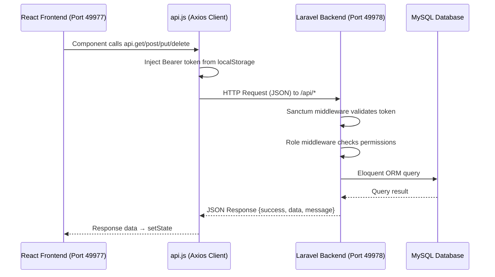
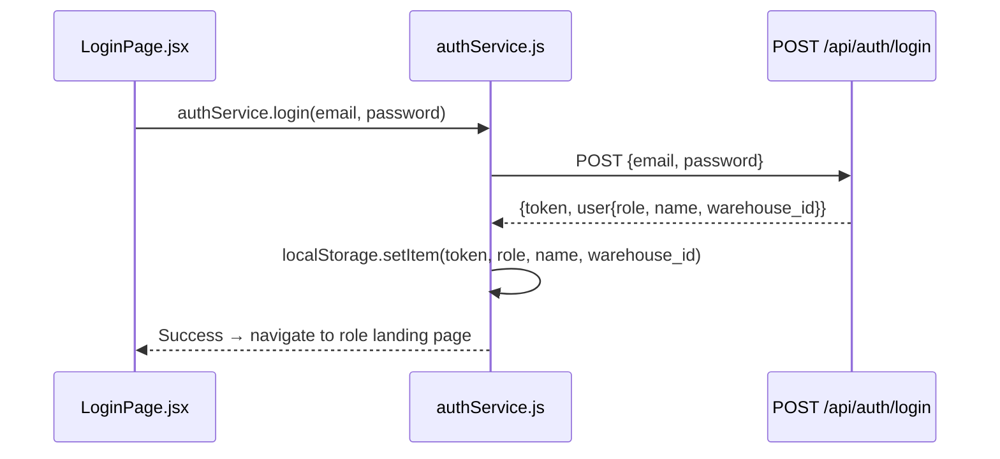
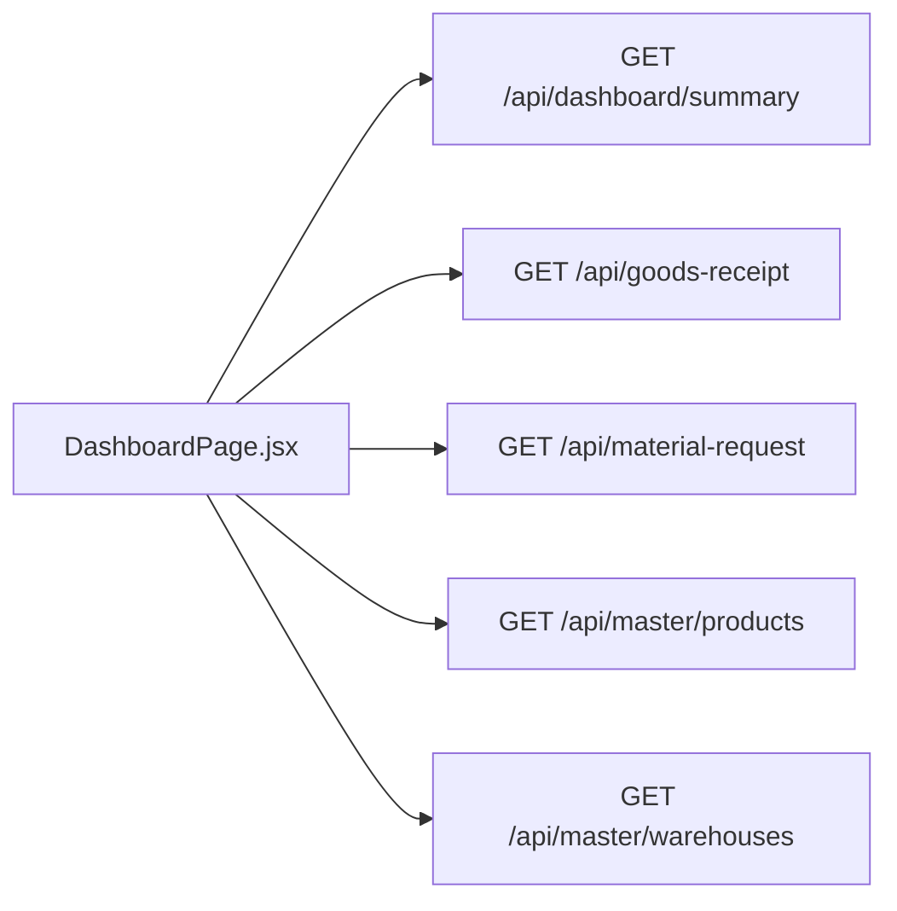
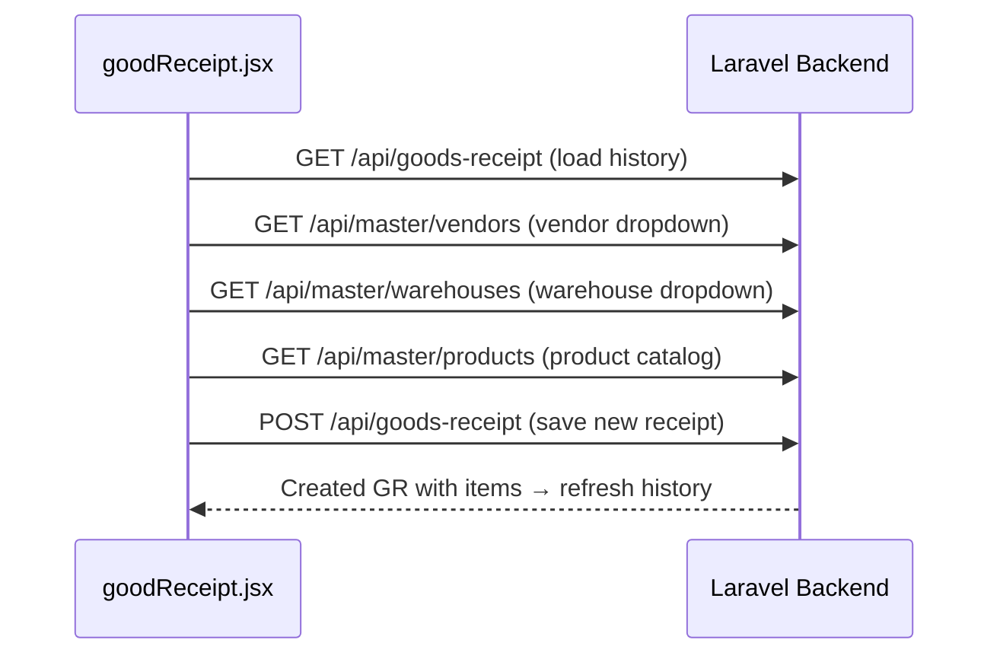
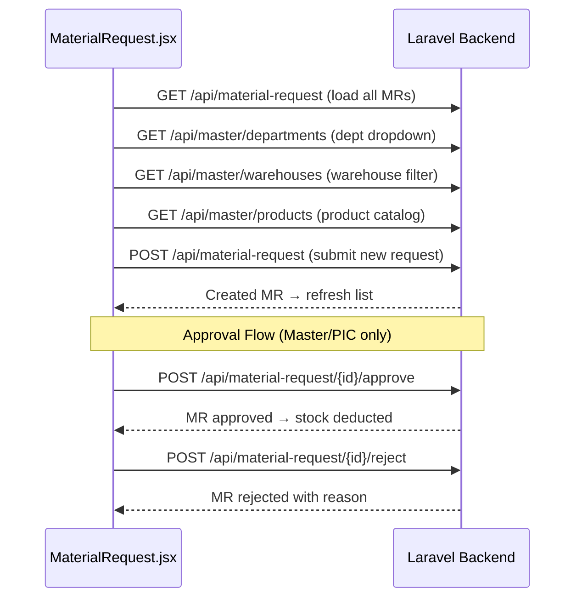
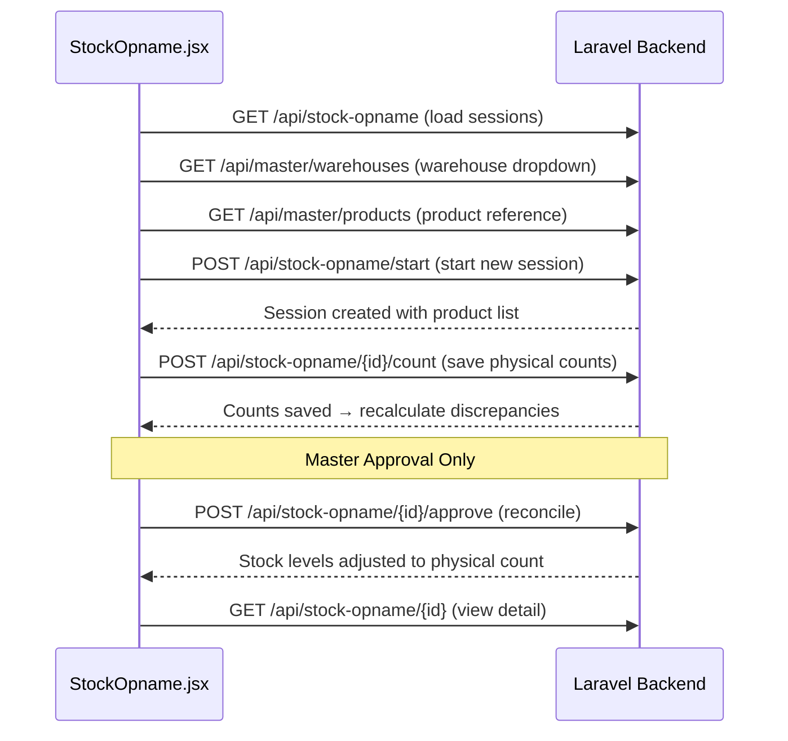

# Network API Interactions (HTTP REST)

This document maps all **HTTP-based** interactions between the React Frontend and the Laravel Backend. Every call listed here crosses the network boundary via the Axios client (`api.js`) to the Laravel API (`routes/api.php`).

---

## Table of Contents

- [Communication Architecture](#communication-architecture)
- [Authentication Flow](#authentication-flow)
- [Dashboard](#dashboard)
- [Master Data CRUD](#master-data-crud)
- [Goods Receipt & QC Inspection](#goods-receipt--qc-inspection)
- [Material Request](#material-request)
- [Stock Opname](#stock-opname)
- [Stock Overview](#stock-overview)
- [Complete API Endpoint Registry](#complete-api-endpoint-registry)

---

## Communication Architecture

**Base URLs:**
- Frontend Dev Server: `http://localhost:49977`
- Backend API Server: `http://localhost:49978/api`

**Authentication:** Laravel Sanctum (Bearer Token in `Authorization` header)

**Request/Response Format:** All payloads use `Content-Type: application/json`

---

## Authentication Flow

### Login (`LoginPage.jsx` → `AuthController@login`)

| Frontend File | Method | Backend Endpoint | Controller Method | Auth |
|--------------|--------|-----------------|-------------------|:----:|
| `LoginPage.jsx` → `authService.login()` | `POST` | `/api/auth/login` | `AuthController@login` | Public |
| `RegisterPage.jsx` → `authService.register()` | `POST` | `/api/auth/register` | `AuthController@register` | Public |
| `Sidebar.jsx` → `authService.logout()` | `POST` | `/api/auth/logout` | `AuthController@logout` | 🔒 |

### Register — Dynamic Warehouse Fetch

| Frontend File | Method | Backend Endpoint | Purpose |
|--------------|--------|-----------------|---------|
| `RegisterPage.jsx` | `GET` | `/api/master/warehouses` | Populate warehouse dropdown on registration form |

---

## Dashboard

### `DashboardPage.jsx` → Multiple Endpoints

The Dashboard page fires **5 parallel API calls** on mount to populate all panels:

| Method | Backend Endpoint | Controller | Data Returned | UI Panel |
|--------|-----------------|-----------|--------------|----------|
| `GET` | `/api/dashboard/summary` | `DashboardController@summary` | Total SKUs, low stock count, pending MR, pending QC | Summary Cards |
| `GET` | `/api/goods-receipt` | `GoodsReceiptController@index` | All GR records with items | Recent GR Table |
| `GET` | `/api/material-request` | `MaterialRequestController@index` | All MR records with items | Pending MR Table |
| `GET` | `/api/master/products` | `MasterDataController@products` | All products with stock levels | Low Stock Alert Panel |
| `GET` | `/api/master/warehouses` | `MasterDataController@warehouses` | All warehouses | Global Warehouse Filter Dropdown |

---

## Master Data CRUD

### `MasterData.jsx` → `MasterDataController`

This page manages 5 entity types through a unified tabbed interface. All CRUD operations follow the same REST pattern:

```mermaid
graph TD
    MD["MasterData.jsx"]

    MD -->|"GET"| P_R["GET /api/master/products"]
    MD -->|"POST"| P_C["POST /api/master/products"]
    MD -->|"PUT"| P_U["PUT /api/master/products/{id}"]
    MD -->|"DELETE"| P_D["DELETE /api/master/products/{id}"]

    MD -->|"GET"| V_R["GET /api/master/vendors"]
    MD -->|"POST"| V_C["POST /api/master/vendors"]
    MD -->|"PUT"| V_U["PUT /api/master/vendors/{id}"]
    MD -->|"DELETE"| V_D["DELETE /api/master/vendors/{id}"]

    MD -->|"GET"| W_R["GET /api/master/warehouses"]
    MD -->|"POST"| W_C["POST /api/master/warehouses"]
    MD -->|"PUT"| W_U["PUT /api/master/warehouses/{id}"]
    MD -->|"DELETE"| W_D["DELETE /api/master/warehouses/{id}"]

    MD -->|"GET"| D_R["GET /api/master/departments"]
    MD -->|"POST"| D_C["POST /api/master/departments"]
    MD -->|"PUT"| D_U["PUT /api/master/departments/{id}"]
    MD -->|"DELETE"| D_D["DELETE /api/master/departments/{id}"]

    MD -->|"GET"| C_R["GET /api/master/categories"]
```

| Entity | List (GET) | Create (POST) | Update (PUT) | Delete (DELETE) |
|--------|-----------|--------------|-------------|----------------|
| Products | `/api/master/products` | `/api/master/products` | `/api/master/products/{id}` | `/api/master/products/{id}` |
| Vendors | `/api/master/vendors` | `/api/master/vendors` | `/api/master/vendors/{id}` | `/api/master/vendors/{id}` |
| Warehouses | `/api/master/warehouses` | `/api/master/warehouses` | `/api/master/warehouses/{id}` | `/api/master/warehouses/{id}` |
| Departments | `/api/master/departments` | `/api/master/departments` | `/api/master/departments/{id}` | `/api/master/departments/{id}` |
| Categories | `/api/master/categories` | — | — | — |

> **Note:** Categories are read-only reference data; Users are managed through Auth endpoints.

---

## Goods Receipt & QC Inspection

### `goodReceipt.jsx` → `GoodsReceiptController`

| Method | Backend Endpoint | Controller Method | Role Guard | Purpose |
|--------|-----------------|-------------------|:----------:|---------|
| `GET` | `/api/goods-receipt` | `index` | 🔒 Any | Load all GR history with items |
| `GET` | `/api/goods-receipt/{id}` | `show` | 🔒 Any | Load single GR detail |
| `POST` | `/api/goods-receipt` | `store` | 🔒 Master, PIC | Create new goods receipt with items |
| `GET` | `/api/returns` | `returnsList` | 🔒 Any | Load return items list |

### `qcinspection.jsx` → `GoodsReceiptController@recordQC`

| Method | Backend Endpoint | Controller Method | Role Guard | Purpose |
|--------|-----------------|-------------------|:----------:|---------|
| `GET` | `/api/goods-receipt` | `index` | 🔒 Any | Load GRs pending QC inspection |
| `POST` | `/api/goods-receipt/{id}/qc` | `recordQC` | 🔒 Master, QC | Submit QC results (accepted/rejected qty per item) |

**Side Effects of QC Submission:**
- Updates `GoodsReceiptItem` quantities (accepted, rejected)
- Mutates `Stock` table (adds accepted qty to available stock)
- Logs activity via `ActivityLogger`
- Records stock movement via `StockMovementLogger`

---

## Material Request

### `MaterialRequest.jsx` → `MaterialRequestController`

| Method | Backend Endpoint | Controller Method | Role Guard | Purpose |
|--------|-----------------|-------------------|:----------:|---------|
| `GET` | `/api/material-request` | `index` | 🔒 Any | Load all MR records |
| `GET` | `/api/material-request/{id}` | `show` | 🔒 Any | Load single MR detail |
| `POST` | `/api/material-request` | `store` | 🔒 Master, PIC | Create new material request |
| `POST` | `/api/material-request/{id}/approve` | `approve` | 🔒 Master, PIC | Approve MR and deduct stock |
| `POST` | `/api/material-request/{id}/reject` | `reject` | 🔒 Master, PIC | Reject MR with reason |

**Side Effects of Approval:**
- Deducts approved quantities from `Stock` table
- Logs activity via `ActivityLogger`

---

## Stock Opname

### `StockOpname.jsx` → `StockOpnameController`

| Method | Backend Endpoint | Controller Method | Role Guard | Purpose |
|--------|-----------------|-------------------|:----------:|---------|
| `GET` | `/api/stock-opname` | `index` | 🔒 Any | Load all opname sessions |
| `GET` | `/api/stock-opname/{id}` | `show` | 🔒 Any | Load session detail with items |
| `POST` | `/api/stock-opname/start` | `start` | 🔒 Master, PIC | Start new counting session |
| `POST` | `/api/stock-opname/{id}/count` | `saveCounts` | 🔒 Master, PIC | Save physical count entries |
| `POST` | `/api/stock-opname/{id}/approve` | `approve` | 🔒 Master | Reconcile discrepancies and adjust stock |

**Side Effects of Approval:**
- Adjusts `Stock` table quantities to match physical counts
- Creates `StockAdjustment` records for audit trail
- Logs activity via `ActivityLogger`
- Records stock movement via `StockMovementLogger`

---

## Stock Overview

### `StockOverview.jsx` — Read-Only

| Method | Backend Endpoint | Controller Method | Purpose |
|--------|-----------------|-------------------|---------|
| `GET` | `/api/master/products` | `MasterDataController@products` | Load all products with stock levels |
| `GET` | `/api/master/categories` | `MasterDataController@categories` | Load categories for filter dropdown |

> Stock Overview does not write any data. It is a pure read-only view that reuses master data endpoints.

---

## Complete API Endpoint Registry

All HTTP endpoints in the system, ordered by URL path:

| # | Method | Endpoint | Controller | Role Guard | Used By (Frontend) |
|:-:|--------|----------|-----------|:----------:|---------------------|
| 1 | `POST` | `/api/auth/login` | `AuthController@login` | Public | `LoginPage.jsx` |
| 2 | `POST` | `/api/auth/register` | `AuthController@register` | Public | `RegisterPage.jsx` |
| 3 | `POST` | `/api/auth/logout` | `AuthController@logout` | 🔒 Any | `Sidebar.jsx` |
| 4 | `GET` | `/api/auth/profile` | `AuthController@profile` | 🔒 Any | — |
| 5 | `GET` | `/api/dashboard/summary` | `DashboardController@summary` | 🔒 Any | `DashboardPage.jsx` |
| 6 | `GET` | `/api/master/warehouses` | `MasterDataController@warehouses` | 🔒 Any | Dashboard, GR, MR, SO, MasterData, Register |
| 7 | `POST` | `/api/master/warehouses` | `MasterDataController@storeWarehouse` | 🔒 Any | `MasterData.jsx` |
| 8 | `PUT` | `/api/master/warehouses/{id}` | `MasterDataController@updateWarehouse` | 🔒 Any | `MasterData.jsx` |
| 9 | `DELETE` | `/api/master/warehouses/{id}` | `MasterDataController@destroyWarehouse` | 🔒 Any | `MasterData.jsx` |
| 10 | `GET` | `/api/master/departments` | `MasterDataController@departments` | 🔒 Any | MR, MasterData |
| 11 | `POST` | `/api/master/departments` | `MasterDataController@storeDepartment` | 🔒 Any | `MasterData.jsx` |
| 12 | `PUT` | `/api/master/departments/{id}` | `MasterDataController@updateDepartment` | 🔒 Any | `MasterData.jsx` |
| 13 | `DELETE` | `/api/master/departments/{id}` | `MasterDataController@destroyDepartment` | 🔒 Any | `MasterData.jsx` |
| 14 | `GET` | `/api/master/vendors` | `MasterDataController@vendors` | 🔒 Any | GR, MasterData |
| 15 | `POST` | `/api/master/vendors` | `MasterDataController@storeVendor` | 🔒 Any | `MasterData.jsx` |
| 16 | `PUT` | `/api/master/vendors/{id}` | `MasterDataController@updateVendor` | 🔒 Any | `MasterData.jsx` |
| 17 | `DELETE` | `/api/master/vendors/{id}` | `MasterDataController@destroyVendor` | 🔒 Any | `MasterData.jsx` |
| 18 | `GET` | `/api/master/categories` | `MasterDataController@categories` | 🔒 Any | MasterData, StockOverview |
| 19 | `GET` | `/api/master/products` | `MasterDataController@products` | 🔒 Any | Dashboard, GR, MR, SO, StockOverview, MasterData |
| 20 | `POST` | `/api/master/products` | `MasterDataController@storeProduct` | 🔒 Any | `MasterData.jsx` |
| 21 | `PUT` | `/api/master/products/{id}` | `MasterDataController@updateProduct` | 🔒 Any | `MasterData.jsx` |
| 22 | `DELETE` | `/api/master/products/{id}` | `MasterDataController@destroyProduct` | 🔒 Any | `MasterData.jsx` |
| 23 | `GET` | `/api/goods-receipt` | `GoodsReceiptController@index` | 🔒 Any | Dashboard, GR, QC |
| 24 | `GET` | `/api/goods-receipt/{id}` | `GoodsReceiptController@show` | 🔒 Any | GR |
| 25 | `POST` | `/api/goods-receipt` | `GoodsReceiptController@store` | 🔒 Master, PIC | `goodReceipt.jsx` |
| 26 | `POST` | `/api/goods-receipt/{id}/qc` | `GoodsReceiptController@recordQC` | 🔒 Master, QC | `qcinspection.jsx` |
| 27 | `GET` | `/api/returns` | `GoodsReceiptController@returnsList` | 🔒 Any | `goodReceipt.jsx` |
| 28 | `GET` | `/api/material-request` | `MaterialRequestController@index` | 🔒 Any | Dashboard, MR |
| 29 | `GET` | `/api/material-request/{id}` | `MaterialRequestController@show` | 🔒 Any | MR |
| 30 | `POST` | `/api/material-request` | `MaterialRequestController@store` | 🔒 Master, PIC | `MaterialRequest.jsx` |
| 31 | `POST` | `/api/material-request/{id}/approve` | `MaterialRequestController@approve` | 🔒 Master, PIC | `MaterialRequest.jsx` |
| 32 | `POST` | `/api/material-request/{id}/reject` | `MaterialRequestController@reject` | 🔒 Master, PIC | `MaterialRequest.jsx` |
| 33 | `GET` | `/api/stock-opname` | `StockOpnameController@index` | 🔒 Any | `StockOpname.jsx` |
| 34 | `GET` | `/api/stock-opname/{id}` | `StockOpnameController@show` | 🔒 Any | `StockOpname.jsx` |
| 35 | `POST` | `/api/stock-opname/start` | `StockOpnameController@start` | 🔒 Master, PIC | `StockOpname.jsx` |
| 36 | `POST` | `/api/stock-opname/{id}/count` | `StockOpnameController@saveCounts` | 🔒 Master, PIC | `StockOpname.jsx` |
| 37 | `POST` | `/api/stock-opname/{id}/approve` | `StockOpnameController@approve` | 🔒 Master | `StockOpname.jsx` |
| 38 | `GET` | `/api/purchase-orders` | `PurchaseOrderController@index` | 🔒 Any | — (future) |
| 39 | `GET` | `/api/purchase-orders/{id}` | `PurchaseOrderController@show` | 🔒 Any | — (future) |
| 40 | `POST` | `/api/purchase-orders` | `PurchaseOrderController@store` | 🔒 Master | — (future) |
| 41 | `POST` | `/api/purchase-orders/{id}/receive` | `PurchaseOrderController@receive` | 🔒 Master, PIC | — (future) |
| 42 | `GET` | `/api/putaway` | `PutawayController@index` | 🔒 Any | — (future) |
| 43 | `POST` | `/api/putaway` | `PutawayController@store` | 🔒 Master, PIC | — (future) |
| 44 | `GET` | `/api/goods-issue` | `GoodsIssueController@index` | 🔒 Any | — (future) |
| 45 | `POST` | `/api/goods-issue` | `GoodsIssueController@store` | 🔒 Master, PIC | — (future) |
| 46 | `GET` | `/api/reports/activity-logs` | `ActivityLogController@index` | 🔒 Master | — (future) |
| 47 | `GET` | `/api/reports/stock-movements` | `ActivityLogController@stockMovements` | 🔒 Any | — (future) |

> Endpoints marked **"(future)"** are registered in the backend and fully functional, but do not yet have a dedicated frontend page component.
