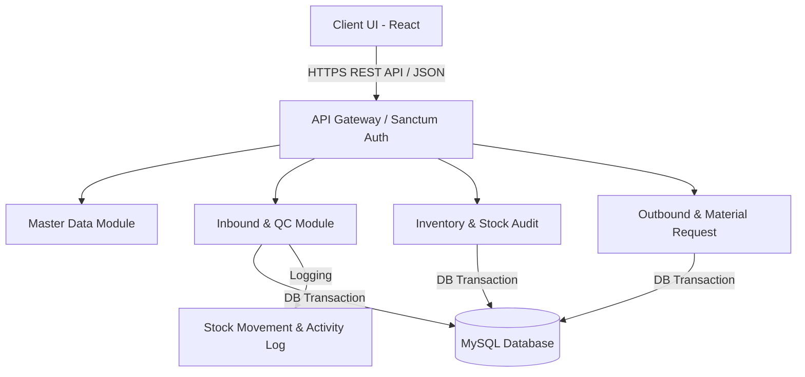

# WMS Project Estimation & Technical Breakdown

This document provides a highly detailed technical specification and financial breakdown for the **Warehouse Management System (WMS)** built for President University Capstone Design Project. The system integrates full enterprise business workflows with modern frontend interfaces.

---

## 1. Technical Architecture & Database Design

The project is structured as a decoupled **three-tier web application** optimized for high data integrity, strict role-based access control, and asynchronous operations.

### 1.1 Technical Stack
- **Backend Framework**: Laravel 10.x (PHP 8.1+) utilizing Eloquent ORM, Sanctum for token authentication, and DB Transactions for ACID compliance.
- **Frontend Layer**: React.js (Vite, React Router DOM, Axios, custom CSS variables for light/dark theme persistence).
- **Database Layer**: MySQL 8.0 containing relational tables with cascading integrity.
- **Document Rendering**: DomPDF for dynamic PDF report generation with signature configurations.

### 1.2 Entity Relationship & Database Schema
The database contains 24 core tables structured as follows:

| Table Name | Purpose / Core Fields |
| :--- | :--- |
| `users` | Stores accounts with `role_id` and `warehouse_id` for boundary-enforced access. |
| `roles` | Defines roles: `Master` (full administration), `PIC` (warehouse supervisor), `QC` (quality inspector). |
| `warehouses` | Stores multi-warehouse locations (`warehouse_name`, `address`, `city`). |
| `warehouse_signatures` | Stores dynamic signature metadata configuration for PDF document exports. |
| `vendors` | Vendor information linked to products. |
| `product_categories` | Hierarchical categorizations of products. |
| `products` | Core catalog with internal codes, unit of measures, and safety stock thresholds. |
| `vendor_products` | Mapping table establishing vendor codes and unit prices per item. |
| `departments` | Internal corporate departments requesting inventory. |
| `stock` | Live inventory balance records tracked by `zone`, `rack`, and `bin`. |
| `goods_receipts` | Inbound headers documenting shipments, PO references, and receiver details. |
| `goods_receipt_items`| Line items for receipts detailing expected, accepted, and rejected amounts. |
| `return_items` | Active records of items failed in QC and slated for vendor returns. |
| `material_requests` | Outbound request headers submitted by departments. |
| `material_request_items`| Line items requested and subsequently issued. |
| `stock_opnames` | Audit session headers tracking periodic physical counting. |
| `stock_opname_items` | Comparison ledger recording system qty, physical qty, and calculated discrepancy. |
| `stock_adjustments` | Historical audit logs of all approved stock opname modifications. |
| `stock_movements` | A centralized, immutable double-entry ledger recording all physical stock additions/deductions. |
| `activity_logs` | System audit trail tracking all actions, IP addresses, and user-agents. |
| `password_reset_requests`| Secure management of administrator-approved password resets. |
| `purchase_orders` | Tracks procurement cycles and integrates with receipt flows. |
| `putaways` | Manages stage placement of received inventory to standard zones. |
| `goods_issues` | Records shipping and physical dispatch of items. |

---

## 2. Technical Breakdown by Module

The following section maps the system's requirements into specific development modules, detailing the technical components built for each.

### Module 1: Authentication & Role-Based Access Control (RBAC)
- **Backend Components**:
  - Laravel Sanctum token-issuing handlers.
  - Role verification middleware (`role:Master,PIC,QC`).
  - Secure password hashing and reset request endpoints with Master approval triggers.
- **Frontend Components**:
  - Responsive Login Page, persistent state handlers, protected routing wrappers blocking unauthorized views.

### Module 2: Master Data Management
- **Backend Components**:
  - Full CRUD operations with request validators for Warehouses, Departments, Vendors, Products, and Users.
  - Custom column configuration API for dynamic signature layouts on PDF receipts.
- **Frontend Components**:
  - Form validation with inline error messaging, dynamic tables, search/filter bars, and creation modems.

### Module 3: Inbound Subsystem (Goods Receipt & QC)
- **Backend Components**:
  - Multi-level Goods Receipt creation endpoints.
  - Quality Control inspection engine (reconciles expected, accepted, and rejected quantities, triggers stock increments on acceptance, generates Return entries on rejection).
  - Transaction-safe edit workflows for adjusting accepted/rejected proportions.
- **Frontend Components**:
  - Inbound entry wizards, dynamic QC input tables with safety validations, returns list dashboard.

### Module 4: Putaway & Storage Placement
- **Backend Components**:
  - Stage placement trackers mapping received items to specific zones, racks, and bins.
  - Location stock adjustments.
- **Frontend Components**:
  - Location selection tables and status trackers.

### Module 5: Inventory Audit & Stock Opname
- **Backend Components**:
  - Auditing session engine. Counts are saved in an `in_progress` state and discrepancies computed automatically.
  - Master-approval endpoints executing actual physical stock adjustments and logging differences.
- **Frontend Components**:
  - Count sheet entry forms, discrepancy alert panels, and administrative approval consoles.

### Module 6: Outbound & Material Requests
- **Backend Components**:
  - Department request submissions, stock checks, approval workflows, and Goods Issue generation.
- **Frontend Components**:
  - Outbound request wizards, stock availability visualizers, and dispatch logs.

### Module 7: Reports, Audit Trails & Analytics
- **Backend Components**:
  - Immutable stock movement ledgers, security action logs, and PDF export engines utilizing signature metadata.
- **Frontend Components**:
  - Interactive dashboard with multi-warehouse filtering, low-stock indicators, and PDF download controls.

---

## 3. Financial Cost Breakdown & Estimation

This section outlines the financial estimation based on development effort. It contrasts the **Standard Commercial Market Value** against the **Special Academic Discount** provided for the Capstone Project.

### 3.1 Base Cost Model
- **Developer Rate**: IDR 100,000 / hour (Based on senior-level full-stack expertise with over 6 years of professional industry experience, offered at a subsidized rate for academic final project purposes).
- **Equivalent Billed Hours (Post-Discount)**: 14 Hours.
- **Final Net Price**: IDR 1,400,000.

### 3.2 Detailed Effort Estimation & Pricing Table

| Module | Scope / Key Features | Std. Hrs | Std. Price | Billed Hrs | Billed Price |
| :--- | :--- | :---: | :---: | :---: | :---: |
| **M1: Auth & RBAC** | Sanctum setup, roles middleware, login views, reset pipelines. | 12 | Rp 1.200.000 | 1.0 | Rp 100.000 |
| **M2: Master Data** | Warehouses, Vendors, Products, Users, Signatures CRUD & Views. | 26 | Rp 2.600.000 | 2.0 | Rp 200.000 |
| **M3: Inbound & QC** | Goods receipt, QC findings, returns tracking, stock increments. | 32 | Rp 3.200.000 | 3.0 | Rp 300.000 |
| **M4: Putaway** | Zone, rack, bin allocation and placement tracking. | 16 | Rp 1.600.000 | 1.5 | Rp 150.000 |
| **M5: Stock Opname** | Audit sessions, discrepancy calculations, adjustment approvals. | 24 | Rp 2.400.000 | 2.0 | Rp 200.000 |
| **M6: Outbound** | Material requests, approval gates, stock decrements, Goods Issue. | 18 | Rp 1.800.000 | 1.5 | Rp 150.000 |
| **M7: Dashboard & Reports** | Consolidated metrics, movement ledgers, PDF rendering engines. | 22 | Rp 2.200.000 | 2.0 | Rp 200.000 |
| **M8: Deployment** | Docker environments, nginx configurations, seeders. | 10 | Rp 1.000.000 | 1.0 | Rp 100.000 |
| **TOTALS** | **Full WMS Enterprise System** | **160** | **Rp 16.000.000** | **14.0** | **Rp 1.400.000** |

---

## 4. Discount Justification Analysis

The project receives a **91.25% total discount** (saving IDR 14,600,000) based on the following structural factors:

1. **Pre-Built Library & Experience Re-use (80% Weight)**:
   - The developer has extensive experience building and deploying similar inventory and warehouse management systems.
   - Core boilerplates (Sanctum authentication, audit logging middleware, dynamic React-Table hooks, and CSS styling layouts) were re-used, bypassing the expensive exploratory development phase.
   - Common pitfalls (like partial QC splits and stock opname discrepancy calculation logic) had pre-optimized solutions.

2. **Academic Context & Risk Reduction (11.25% Weight)**:
   - The project is deployed for a Capstone Design (Tugas Akhir) at President University, not for high-stakes, 24/7 commercial operations.
   - **Reduced Liability**: There are no strict commercial SLA (Service Level Agreement) penalties, data-loss liabilities, or security compliance audits.
   - **Low Maintenance Overhead**: Ongoing maintenance, server monitoring, and professional support are not included in the scope, significantly reducing long-term developer commitment.

---

## 5. System Quality Verification

To ensure academic excellence, the system underwent strict QA cycles:
- **Automated Validation**: Integrated unit and integration tests verifying roles routing, transaction integrity, and stock adjustment calculations.
- **Manual Verification**: Simulating end-to-end inbound, QC split, and opname approval flows using mock data in local staging environments.
