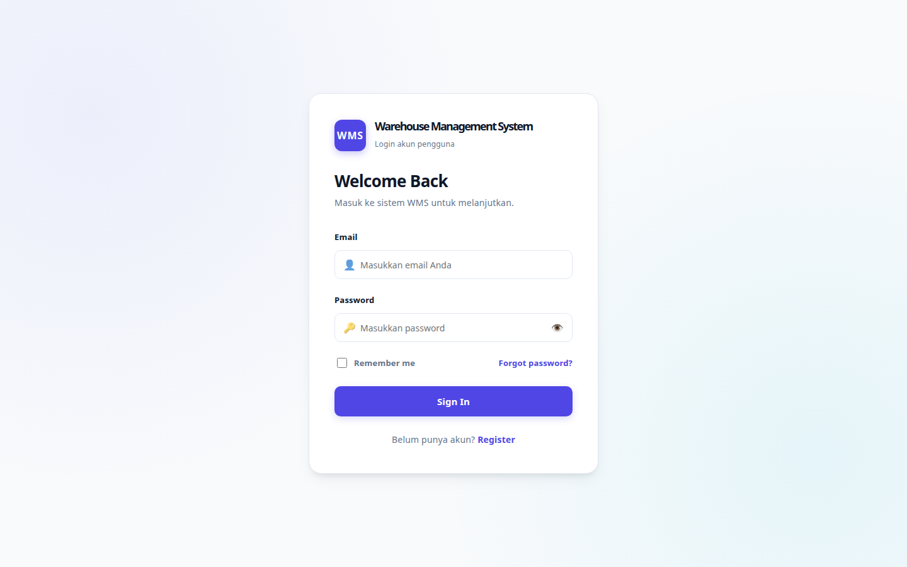
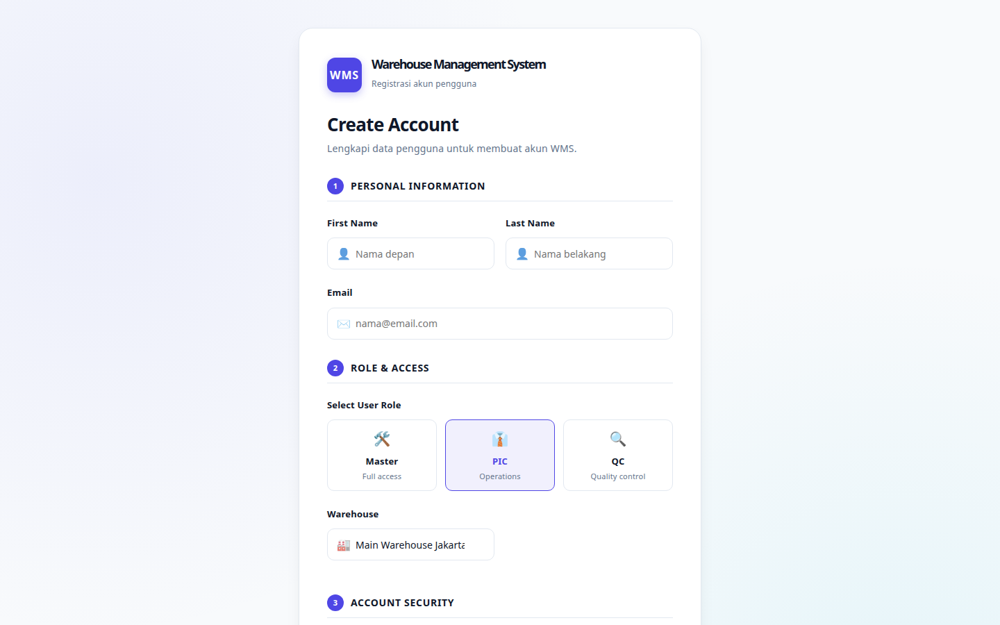
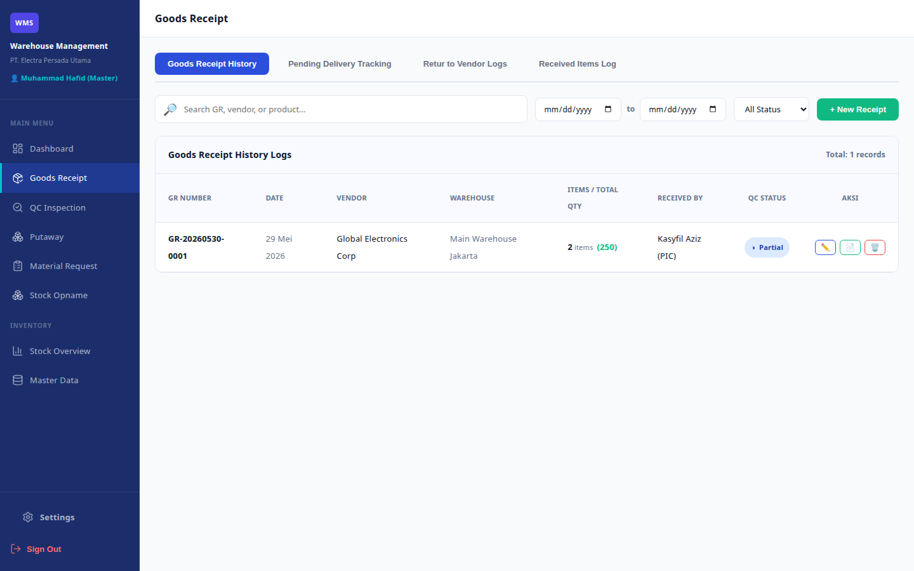
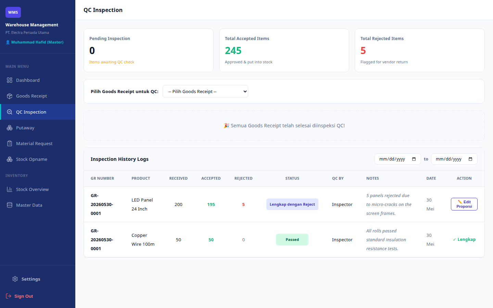
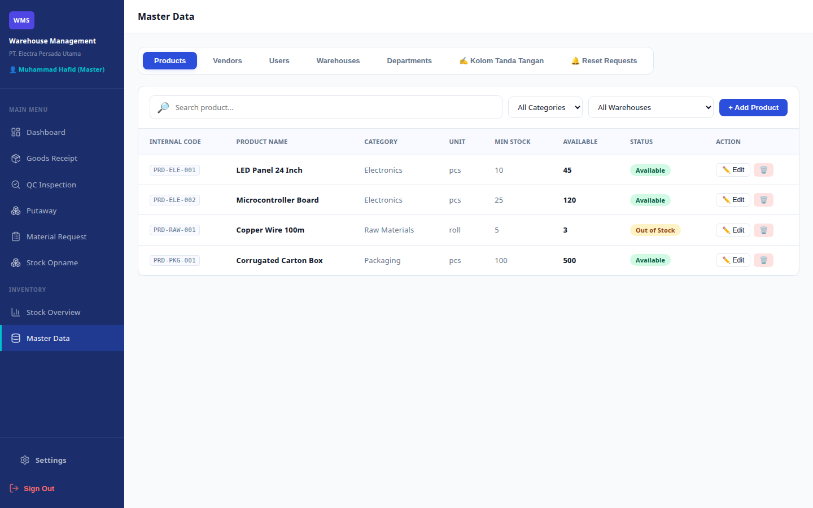
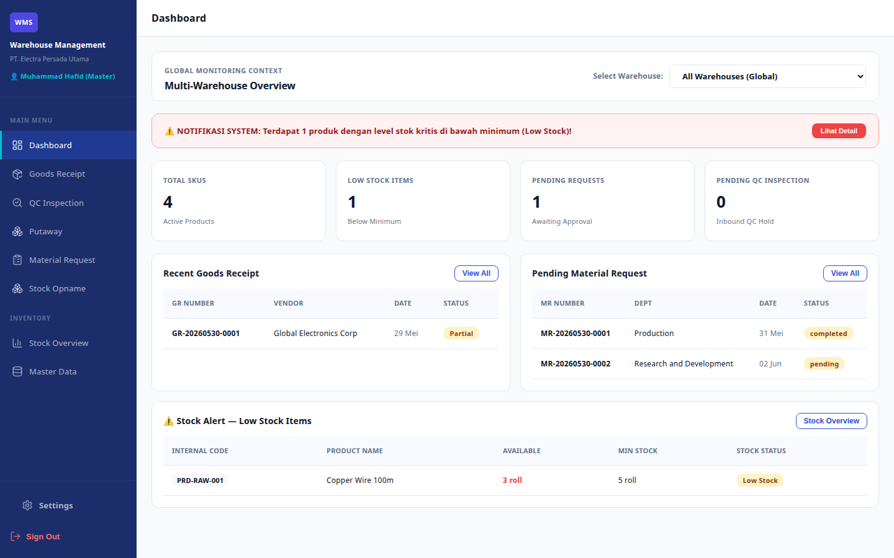
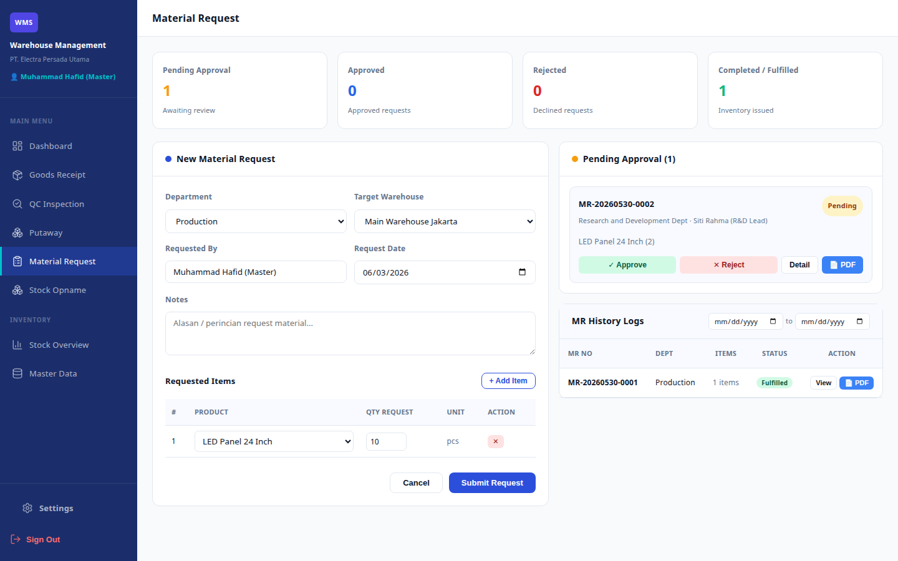
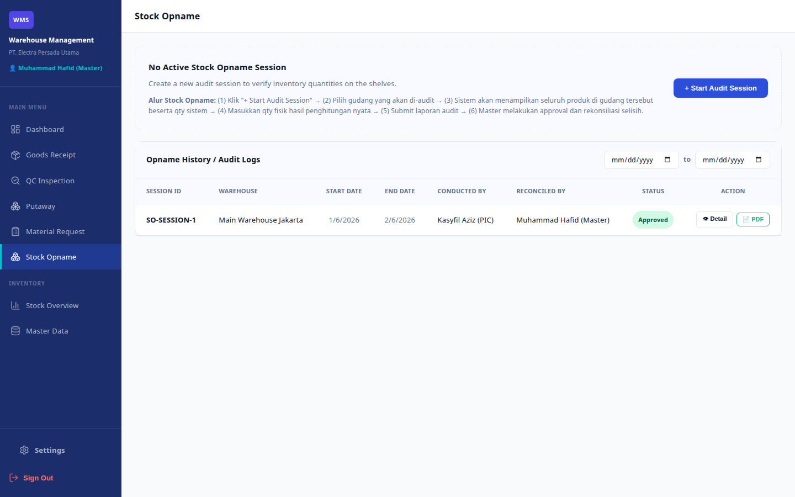
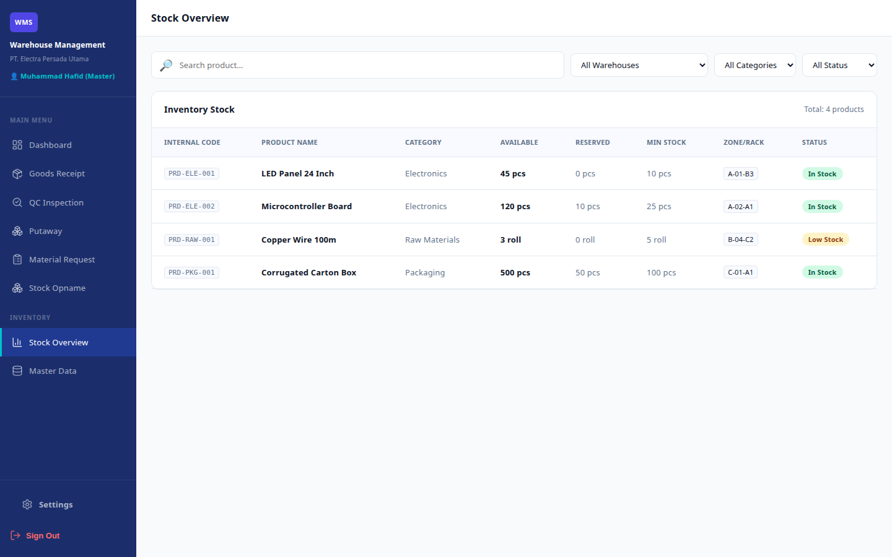

# Dokumentasi Alur Pengguna — Warehouse Management System

Dokumen ini menjelaskan alur pengguna lengkap untuk semua role yang tersedia di aplikasi WMS, disertai screenshot yang diambil langsung dari aplikasi yang berjalan.

---

## Daftar Isi

- [Autentikasi (Publik)](#autentikasi-publik)
  - [Login](#login)
  - [Registrasi](#registrasi)
- [Role: Master](#role-master)
  - [Dashboard](#master--dashboard)
  - [Penerimaan Barang](#master--penerimaan-barang)
  - [Inspeksi QC](#master--inspeksi-qc)
  - [Permintaan Material](#master--permintaan-material)
  - [Stock Opname](#master--stock-opname)
  - [Ikhtisar Stok](#master--ikhtisar-stok)
  - [Data Master](#master--data-master)
- [Role: PIC (Person In Charge)](#role-pic-person-in-charge)
  - [Penerimaan Barang](#pic--penerimaan-barang)
  - [Permintaan Material](#pic--permintaan-material)
  - [Stock Opname](#pic--stock-opname)
  - [Ikhtisar Stok](#pic--ikhtisar-stok)
- [Role: QC (Quality Control)](#role-qc-quality-control)
  - [Inspeksi QC](#qc--inspeksi-qc)
  - [Ikhtisar Stok](#qc--ikhtisar-stok)
- [Matriks Akses Role](#matriks-akses-role)

---

## Autentikasi (Publik)

### Login

Semua pengguna memulai sesi mereka di halaman Login. Pengguna memasukkan email dan password yang telah terdaftar untuk mengakses sistem.

**Langkah-langkah:**
1. Buka URL aplikasi.
2. Masukkan alamat email di field "Email".
3. Masukkan password di field "Password".
4. Opsional: centang "Remember me" untuk mempertahankan sesi login.
5. Klik tombol **Sign In**.
6. Sistem akan mengarahkan pengguna ke halaman utama sesuai role-nya.



---

### Registrasi

Pengguna baru dapat membuat akun dengan mengakses halaman Register dari halaman Login.

**Langkah-langkah:**
1. Klik link **Register** di halaman Login.
2. Isi **Nama Depan** dan **Nama Belakang**.
3. Masukkan alamat **Email** yang valid.
4. Pilih **Role Pengguna** (Master, PIC, atau QC) dengan mengklik kartu yang sesuai.
5. Pilih **Gudang** yang ditugaskan dari **dropdown dinamis** yang diambil dari daftar gudang di Data Master.
6. Buat **Password** (minimal 6 karakter) dan konfirmasi ulang.
7. Klik tombol **Create Account**.
8. Jika berhasil, pengguna akan diarahkan ke halaman Login.



---

## Role: Master

Role **Master** memiliki akses penuh ke semua modul dalam sistem. Ini adalah role level administrator yang mengawasi operasi gudang secara menyeluruh.

**Halaman utama setelah login:** `/dashboard`

**Modul yang dapat diakses:**
- Dashboard
- Penerimaan Barang (Goods Receipt)
- Inspeksi QC (QC Inspection)
- Permintaan Material (Material Request)
- Stock Opname
- Ikhtisar Stok (Stock Overview)
- Data Master (Master Data)

---

### Master — Dashboard

Pusat kendali utama yang menyediakan ringkasan real-time dari kondisi gudang.

**Yang dilihat pengguna:**
- **Filter Gudang Global:** Dropdown dinamis di bagian atas dashboard untuk memfilter seluruh konteks sesi berdasarkan "Semua Gudang" atau lokasi gudang tertentu. Saat gudang baru ditambahkan di Data Master, otomatis muncul di sini.
- **Kartu Ringkasan Dinamis:** Total SKU, Item Stok Rendah, Permintaan Tertunda, dan Inspeksi QC Tertunda. Kartu ini diperbarui otomatis sesuai cakupan gudang yang dipilih.
- **Tabel Penerimaan Barang Terbaru:** Kiriman masuk terbaru yang difilter secara dinamis per gudang beserta pencarian dan filter status.
- **Tabel Permintaan Material Tertunda:** Permintaan material yang belum diproses beserta departemen, tanggal, dan status, dapat difilter per gudang.
- **Panel Peringatan Stok:** Produk yang telah turun di bawah ambang batas stok minimum, dicakup secara dinamis per gudang.

**Aksi yang tersedia:**
- Klik **View All** untuk memperluas tabel lengkap Penerimaan Barang atau Permintaan Material langsung di dashboard.
- Klik **Stock Overview** untuk melihat ikhtisar inventori secara menyeluruh.
- Pilih gudang di filter global untuk mengganti konteks pemantauan seluruh panel secara bersamaan.


---

### Master — Penerimaan Barang

Modul untuk mencatat dan melacak penerimaan barang dari vendor.

**Yang dilihat pengguna:**
- **Bar Navigasi Tab** di bagian atas dengan tab: **History** (default), **Pending Delivery**, **Retur**, **Received Items Log**, dan **New Receipt**.
- Kolom pencarian dan filter status untuk record yang sudah ada.
- **Form Penerimaan Barang Baru** dengan nomor GR yang auto-generate, pemilih tanggal, pemilih vendor (dinamis dari Data Master), tipe penerimaan, dan kolom catatan. Input kuantitas default ke **0** dan mendukung **nilai desimal** (misal 10.5 meter) via `step="any"`.
- **Tabel Item Diterima** dengan kode produk vendor, nama produk, kategori, input kuantitas, dan satuan.
- **Tab Received Items Log:** Log pelacakan historis khusus yang menampilkan riwayat barang masuk dengan kolom **Tanggal**, **Nama Produk**, **Qty Diterima**, **Nama Vendor**, **Kode Vendor**, dan **Referensi GR**.
- **Tabel Riwayat Penerimaan Barang** menampilkan semua record sebelumnya beserta nomor GR, tanggal, vendor, jumlah item, PIC, dan status QC.

**Alur kerja:**
1. Klik tab **"New Receipt"** untuk membuka form entri.
2. Pilih vendor dan isi tanggal/catatan.
3. Tambahkan item dan masukkan kuantitas (mendukung desimal untuk satuan meter/roll).
4. Klik **"Simpan Penerimaan"** untuk menyimpan.
5. Klik tab **"Received Items Log"** untuk melihat riwayat pelacakan inbound secara granular per tanggal, vendor, dan produk.



---

### Master — Inspeksi QC

Modul untuk inspeksi quality control terhadap barang yang diterima.

**Yang dilihat pengguna:**
- **Bar Navigasi Tab** di bagian atas dengan tab: **Verifikasi & Validasi QC** (default) dan **Riwayat QC** (riwayat).
- **Kartu ringkasan:** Menunggu Inspeksi, Lolos Hari Ini, Ditolak Hari Ini.
- **Panel Inspeksi Aktif** menampilkan GR yang sedang diinspeksi, dengan visualisasi progress (Diterima → Inspeksi → Update Stok). Semua kuantitas inspeksi default ke **0** dan mendukung **nilai desimal** via `step="any"`.
- **Field QC per item:** Untuk setiap item — kuantitas diterima, kuantitas ditolak, tombol aksi cepat (Accept All / Reject All), dan validasi bahwa `qty_diterima + qty_ditolak = qty_masuk`.
- **Area Catatan QC** untuk mencatat hasil observasi inspeksi per item.
- **Tab Riwayat QC:** Tab riwayat khusus yang menampilkan semua inspeksi sebelumnya dengan kolom **Tanggal**, **Item Lolos (qty)**, **Item Ditolak (qty)**, **Item Pending (qty)**, **Catatan QC**, **Nama Inspektor QC**, dan **Status Akhir**.

**Alur kerja:**
1. Klik tab **"Verifikasi & Validasi QC"** untuk membuka workspace inspeksi.
2. Pilih Penerimaan Barang yang tertunda dari dropdown.
3. Masukkan kuantitas yang diterima dan ditolak per item (mendukung desimal untuk meter/roll).
4. Tulis catatan inspeksi QC.
5. Kirimkan hasil QC untuk memicu penyesuaian stok.
6. Klik tab **"Riwayat QC"** untuk melihat log riwayat inspeksi lengkap.



---

### Master — Permintaan Material

Modul untuk mengelola permintaan material internal dari departemen.

**Yang dilihat pengguna:**
- **Bar Navigasi Tab** di bagian atas dengan tab: **Buat Request Baru** (buat baru) dan **Riwayat Request** (riwayat).
- **Kartu ringkasan:** Menunggu Persetujuan, Disetujui, Ditolak, Selesai.
- **Form Permintaan Material Baru** dengan nomor MR auto-generate, pemilih departemen (dinamis dari Data Master), nama pemohon, tanggal, dan catatan.
- **Tabel Item yang Diminta** dengan nama produk, kuantitas (mendukung **nilai desimal**), tampilan satuan (pcs/meter/roll), dan tombol hapus.
- **Panel Menunggu Persetujuan** menampilkan permintaan yang menunggu review dengan tombol Setujui/Tolak/Detail.
  > [!IMPORTANT]
  > Aksi persetujuan dibatasi hanya untuk role **Master** dan **PIC** untuk menegakkan keamanan alur permintaan.
- **Modal Detail Item:** Popup menampilkan kolom **Nama Departemen**, **Nama Produk**, **Kode Produk**, **Qty Diminta**, **Satuan**, dan **Qty Dipenuhi**.
- **Tab Riwayat Request:** Tab riwayat khusus yang menampilkan semua record sebelumnya dengan Nomor MR, departemen, total item, status, tanggal, dan tombol aksi.

**Alur kerja:**
1. Klik tab **"Buat Request Baru"** untuk membuka form permintaan.
2. Buat permintaan dengan menentukan departemen, menambahkan produk, dan memasukkan kuantitas.
3. Klik **"Submit Request"** untuk mengirim persetujuan.
4. PIC atau Master meninjau permintaan dan klik Setujui atau Tolak.
5. Klik **"Detail"** untuk mengaudit kode produk, detail satuan, dan tingkat pemenuhan.
6. Klik tab **"Riwayat Request"** untuk melihat riwayat permintaan lengkap.

````carousel

<!-- slide -->

````

---

### Master — Stock Opname

Modul untuk melakukan penghitungan fisik stok dan rekonsiliasi.

**Yang dilihat pengguna:**
- **Bar Navigasi Tab** di bagian atas dengan tab: **Audit Stock Opname** (entri) dan **Riwayat Audit** (riwayat).
- **Banner Sesi Aktif** dengan ID sesi, tanggal mulai, gudang, PIC, dan penghitung (Total SKU).
- **Tabel Entri Penghitungan Fisik** dengan pencarian dan filter zona, menampilkan kode internal, nama produk, kategori, zona/rak, kuantitas sistem, input kuantitas fisik (mendukung **nilai desimal**), selisih terhitung (berkode warna: hijau untuk surplus, merah untuk defisit), dan kolom catatan.
- **Dialog Catatan Persetujuan:** Master diminta memasukkan catatan rekonsiliasi/persetujuan opsional saat menyelesaikan sesi.
- **Popup Detail Audit (tombol 👁):** Modal komprehensif yang menampilkan detail seluruh sesi:
  - Header dengan nama gudang, nama pelaksana, nama pemberi persetujuan, badge status, dan catatan persetujuan.
  - Daftar item lengkap dengan kolom: **Nama Produk**, **Kategori Produk**, **Posisi Gudang (Zona/Rak)**, **Qty Sistem**, **Qty Fisik**, **Selisih (Discrepancy)**, **Satuan**, dan **Catatan per Item**.
- **Tab Riwayat Audit:** Tabel riwayat berisi daftar seluruh sesi sebelumnya dengan tanggal, gudang, pelaksana, pemberi persetujuan, badge status, dan tombol aksi **👁 Lihat Detail**.

**Alur kerja:**
1. Klik tab **"Audit Stock Opname"** untuk memulai atau melanjutkan sesi penghitungan.
2. Pilih gudang dan masukkan jumlah fisik stok.
3. Tinjau selisih (hijau = surplus, merah = defisit).
4. Kirimkan laporan untuk persetujuan Master.
5. Master klik **Reconcile & Approve**, masukkan catatan rekonsiliasi opsional, dan database secara otomatis menyesuaikan level stok.
6. Klik tab **"Riwayat Audit"**, lalu klik **👁** pada sesi mana pun untuk melihat detail selisih lengkap, zona, dan catatan persetujuan.


---

### Master — Ikhtisar Stok

Tampilan inventori read-only untuk semua produk di seluruh gudang.

**Yang dilihat pengguna:**
- Kolom pencarian dengan filter kategori dan status.
- **Tabel Stok Inventori** dengan Kode Internal, Nama Produk, Kategori, Kuantitas Tersedia, Kuantitas Dipesan, Ambang Batas Stok Minimum, Lokasi Zona/Rak, dan badge Status stok (Tersedia / Stok Rendah / Habis).

````carousel

<!-- slide -->

````

---

### Master — Data Master

Modul administratif untuk mengelola semua data referensi dalam sistem. Ini adalah **pusat pencatatan terpusat** — semua dropdown di seluruh aplikasi (gudang, departemen, produk, vendor) diisi secara dinamis dari Data Master.

**Yang dilihat pengguna:**
- **Tab bar** untuk berpindah antara: **Produk**, **Vendor**, **Pengguna**, **Gudang**, **Departemen**.
- Setiap tab menampilkan tabel yang dapat dicari dan difilter dengan field yang relevan serta tombol aksi Edit/Hapus.
- **Konfirmasi Keamanan Hapus:** Semua aksi hapus memunculkan dialog konfirmasi ("Apakah Anda yakin ingin menghapus data master ini?") untuk mencegah penghapusan tidak disengaja.
- **Badge Status Produk Dinamis:** Daftar produk secara otomatis menghitung dan menampilkan ketersediaan stok:
  - **Available:** Stok > min_stock.
  - **Out of Stock:** Stok < min_stock.
  - **Empty:** Stok = 0.
- **Dukungan Kuantitas Desimal:** Min Stock dan semua field kuantitas mendukung nilai desimal (misal 10.5 meter) via `step="any"`.
- **Dropdown Gudang Dinamis di Form User:** Penugasan user ke gudang menggunakan dropdown yang diisi otomatis dari tab Gudang.
- Tombol **+ Add** untuk membuat record baru di setiap tab dengan form modal CRUD lengkap.

**Tab yang tersedia:**
| Tab          | Field yang Ditampilkan                                                      | CRUD |
|--------------|-----------------------------------------------------------------------------|:----:|
| Produk       | Kode Internal, Nama, Kategori, Satuan, Stok Minimum, Tersedia, Status       | ✅ |
| Vendor       | Nama, Contact Person, Telepon, Email, Status                                | ✅ |
| Pengguna     | Nama Lengkap, Email, Role, Gudang (dropdown dinamis), Status                | ✅ |
| Gudang       | Nama, Alamat, Kota, PIC, Status                                            | ✅ |
| Departemen   | Nama, Kepala, Total Pengguna, Status                                        | ✅ |

> [!IMPORTANT]
> Menambahkan gudang baru di sini secara otomatis memperbarui dropdown gudang di seluruh form di sistem (Registrasi, Penerimaan Barang, Stock Opname, Manajemen User), memastikan skalabilitas berkelanjutan.

#### Alur Kerja Admin & CRUD Interaktif:
````carousel

<!-- slide -->

<!-- slide -->

<!-- slide -->

<!-- slide -->

<!-- slide -->

<!-- slide -->

<!-- slide -->

<!-- slide -->

<!-- slide -->

<!-- slide -->

<!-- slide -->

````

---

## Role: PIC (Person In Charge)

Role **PIC** menangani operasi gudang sehari-hari termasuk penerimaan barang, permintaan material, dan penghitungan stok. PIC **tidak** memiliki akses ke modul Dashboard, Inspeksi QC, atau Data Master.

**Halaman utama setelah login:** `/goods-receipt`

**Modul yang dapat diakses:**
- Penerimaan Barang (Goods Receipt)
- Permintaan Material (Material Request)
- Stock Opname
- Ikhtisar Stok (Stock Overview)

---

### PIC — Penerimaan Barang

Fungsionalitas sama dengan tampilan Master. PIC dapat membuat penerimaan barang baru, menambahkan item, dan melihat riwayat.



---

### PIC — Permintaan Material

Fungsionalitas sama dengan tampilan Master. PIC dapat membuat permintaan material baru, melihat persetujuan tertunda, dan melihat riwayat.



---

### PIC — Stock Opname

Fungsionalitas sama dengan tampilan Master. PIC dapat melakukan penghitungan fisik stok, mencatat selisih, dan mengirim untuk persetujuan.



---

### PIC — Ikhtisar Stok

Tampilan inventori read-only. Fungsionalitas sama dengan tampilan Master.



---

## Role: QC (Quality Control)

Role **QC** dikhususkan untuk inspeksi kualitas. Personel QC hanya memiliki akses untuk menginspeksi barang yang diterima dan melihat level inventori. QC **tidak** memiliki akses ke modul Dashboard, Penerimaan Barang, Permintaan Material, Stock Opname, atau Data Master.

**Halaman utama setelah login:** `/qc-inspection`

**Modul yang dapat diakses:**
- Inspeksi QC (QC Inspection)
- Ikhtisar Stok (Stock Overview)

---

### QC — Inspeksi QC

Ruang kerja utama untuk pengguna QC. Mereka menginspeksi item dari penerimaan barang, mengisi kuantitas diterima/ditolak, dan mengirimkan hasil inspeksi.


---

### QC — Ikhtisar Stok

Tampilan inventori read-only. Memungkinkan QC untuk memeriksa level stok saat ini sebagai referensi selama inspeksi.


---

## Matriks Akses Role

| Modul               | Master | PIC | QC |
|----------------------|:------:|:---:|:--:|
| Dashboard            |   ✅   |  ❌  | ❌  |
| Penerimaan Barang    |   ✅   |  ✅  | ❌  |
| Inspeksi QC          |   ✅   |  ❌  | ✅  |
| Permintaan Material  |   ✅   |  ✅  | ❌  |
| Stock Opname         |   ✅   |  ✅  | ❌  |
| Ikhtisar Stok        |   ✅   |  ✅  | ✅  |
| Data Master          |   ✅   |  ❌  | ❌  |

---

### Kredensial Akun Pengujian

| Role   | Email            | Password   |
|--------|------------------|------------|
| Master | master@wms.com   | password   |
| PIC    | pic@wms.com      | password   |
| QC     | qc@wms.com       | password   |
